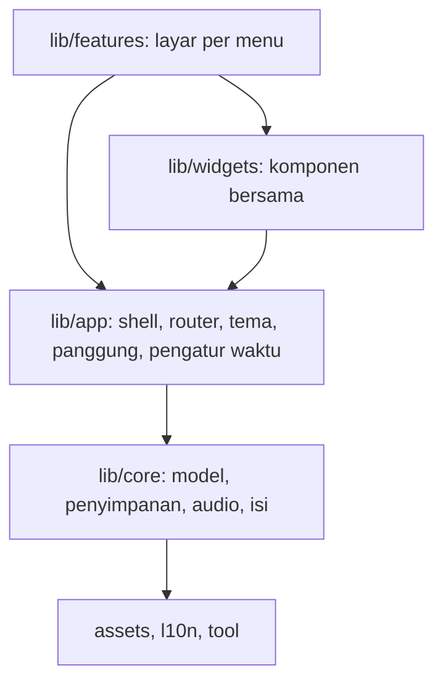

# Arsitektur Moci

Dokumen ini memetakan kode yang sudah dibangun: lapisan, folder, provider, rute, aliran state, dan harness tes. Alasan produk ada di [PRD](docs/PRD.md), rencana teknis lengkap ada di [TECH-SPEC](docs/TECH-SPEC.md), dan data isi ada di [CONTENT-ASSETS](docs/CONTENT-ASSETS.md).

## 1. Lapisan

Panah berarti bergantung. Aturan arahnya:

- `lib/core/` tidak mengimpor `lib/app/`, `lib/features/`, atau `lib/widgets/`. Isinya model, penyimpanan, audio, dan provider.
- `lib/app/` memakai `lib/core/`. Satu-satunya tempat `lib/app` mengenal layar fitur adalah `lib/app/router.dart`.
- `lib/widgets/` memakai tema dan panggung dari `lib/app/`, plus provider `lib/core/`.
- `lib/features/` boleh memakai semuanya.
- `tool/` berjalan tanpa Flutter. Ia hanya mengimpor model murni di `lib/core/content/` dan `lib/core/lang.dart`.

## 2. Peta folder

| Path | Isi |
| --- | --- |
| `lib/main.dart` | `runMoci`: buka penyimpanan, muat progres, katalog aset, dan katalog isi, lalu pasang override |
| `lib/app/moci_app.dart` | `MociApp`: `MaterialApp.router`, locale, lifecycle audio, pemicu Istirahat |
| `lib/app/router.dart` | `go_router`, provider `parentAccessProvider`, `limitReachedProvider`, `currentPathProvider` |
| `lib/app/routes.dart` | Konstanta rute dan `routeKindOf` (D14) |
| `lib/app/redirect.dart` | `resolveRedirect`, aturan redirect murni tanpa Flutter |
| `lib/app/config.dart` | `AppConfig`: URL kebijakan privasi dan email dukungan, masih `null` |
| `lib/app/layout/moci_stage.dart` | `MociStage`, `MociLayoutScope`, `MenuThemeScope` |
| `lib/app/layout/device_layout.dart` | `layoutKindFor`, `fitStage`, ukuran dasar tablet dan HP |
| `lib/app/theme/` | `MociColors`, `MociText`, `MociSize`, `MociMotion`, `MenuTheme`, `mociTheme` |
| `lib/app/play_timer/` | `PlayTimerState`, `tickPlayTimer`, `PlayTimerController` |
| `lib/app/splash/splash_screen.dart` | Splash |
| `lib/core/content/` | `Katalog`, `TracingSet`, `ColoringSet`, `ContentRepository`, `narasi`, `angkaKata` |
| `lib/core/storage/` | `KeyValueStore`, `JsonStore`, `AppFiles`, `BackupExclusion` |
| `lib/core/prefs/` | `AppPrefs`, `PrefsController` |
| `lib/core/progress/` | `Progress`, `ProgressRepository`, `ProgressController` |
| `lib/core/audio/` | `AudioEngine`, `AudioService`, `Narrator`, `Sfx`, `AssetCatalog`, `DeviceTts` |
| `lib/core/providers.dart` | `clockProvider`, `keyValueStoreProvider`, `jsonStoreProvider` |
| `lib/widgets/` | `MociPressable`, `MociButton`, `MociBackButton`, `MociTopBar`, `MociMascot`, `MociIllustration`, `MociDialog`, `NumberKeypad`, `StarCounter` |
| `lib/features/beranda/` | Beranda tablet dan HP, sepuluh kartu menu, sakelar bahasa, bintang, pintu orang tua |
| `lib/features/sambutan/` | Sambutan: bahasa, nama, usia |
| `lib/features/hadiah/` | Hebat, katalog 30 stiker, hadiah ronde |
| `lib/features/istirahat/` | Istirahat dan Waktu Habis |
| `lib/features/orang_tua/` | Gerbang, Area Orang Tua, ringkasan, widget pengaturan |
| `lib/features/hewan/` | Dunia Hewan: 42 hewan, lima kelompok, fakta, suara asli atau tiruan TTS |
| `lib/features/buah_sayur/` | Buah & Sayur: Kenali 35 kartu dan Tebak tiga pilihan berputar |
| `lib/features/warna/` | Warna: set 12 kartu, 11 chip warna, gambar baru dan warna lain |
| `lib/features/bentuk/` | Bentuk: Kenali dengan level usia dan hitung sudut, Cari enam ronde |
| `lib/features/musik/` | Main Musik: xilofon, drum, `MusikAudio`, aturan lagu dan irama |
| `lib/features/segera/` | `ComingSoonScreen` untuk rute yang layarnya belum dibangun |
| `assets/content/katalog.json` | Katalog isi, sumber kebenaran |
| `assets/tracing/` | `huruf.json` dan `angka.json` |
| `assets/coloring/` | `pages.json`, `cap.json`, `krayon.json` |
| `assets/illustrations/` | 111 SVG, dikompilasi `vector_graphics_compiler` saat build |
| `assets/fonts/` | Fredoka dan Nunito, plus lisensi OFL |
| `assets/audio/` | `LICENSES.csv` untuk suara hewan dan instrumen; rekaman narasi `vo/` masuk di Rencana 09 |
| `assets/audio/hewan/` | 42 suara hewan CC0 dari Freesound, dicatat di `assets/audio/LICENSES.csv` |
| `assets/audio/instrumen/` | 12 WAV mono 16-bit 24 kHz hasil sintesis offline, lisensi `Milik sendiri` |
| `l10n/app_id.arb`, `l10n/app_en.arb` | Sumber teks UI; keluaran gen-l10n ada di `lib/l10n/` |
| `tool/validate_content.dart` | Validator isi, juga dipakai CI |
| `tool/konten/` | Parser literal JS, ekspor prototipe sekali, aturan validasi |
| `tool/fonts/build_fonts.sh` | Membangun ulang font subset Latin |
| `tool/buat_instrumen.dart` | Generator 12 WAV xilofon dan drum; hasilnya di-commit, tidak dijalankan saat aplikasi berjalan |
| `test/` | Tes unit dan widget, golden hanya tiga layar |
| `integration_test/app_test.dart` | Empat skenario di perangkat |
| `.github/workflows/ci.yml` | Job tes di Linux dan job golden di macOS |

## 3. Provider dan pemiliknya

| Provider | File | Isi dan pemilik |
| --- | --- | --- |
| `clockProvider` | `lib/core/providers.dart` | `Clock`. Produksi memakai `SystemClock`, tes memakai `FakeClock`. |
| `keyValueStoreProvider` | `lib/core/providers.dart` | `KeyValueStore`. Tidak punya nilai bawaan; diisi `runMoci` dengan `SharedPrefsKeyValueStore` atau `TestEnv` dengan `MemoryKeyValueStore`. |
| `jsonStoreProvider` | `lib/core/providers.dart` | `JsonStore`. Sama: `FileJsonStore` atau `MemoryJsonStore`. |
| `deviceLocaleProvider` | `lib/core/prefs/prefs_controller.dart` | `Locale` perangkat, dipakai untuk bahasa bawaan. |
| `prefsProvider` | `lib/core/prefs/prefs_controller.dart` | `AppPrefs` dan penulisnya ke `shared_preferences`. |
| `initialProgressProvider` | `lib/core/progress/progress_controller.dart` | `Progress` hasil baca `progress.json` saat aplikasi dibuka. |
| `progressProvider` | `lib/core/progress/progress_controller.dart` | `Progress` berjalan dan antrean simpan. |
| `katalogProvider` | `lib/core/content/content_repository.dart` | `Katalog`. Diisi `runMoci`, dilempar kalau belum dioverride. |
| `audioEngineProvider` | `lib/core/audio/audio_providers.dart` | `SoLoudAudioEngine`; tes memakai `FakeAudioEngine`. |
| `assetCatalogProvider` | `lib/core/audio/audio_providers.dart` | `AssetCatalog` dari manifest aset. |
| `deviceTtsProvider` | `lib/core/audio/audio_providers.dart` | `MethodChannelDeviceTts`, dipakai di semua mode build. |
| `audioSessionProvider` | `lib/core/audio/audio_providers.dart` | `MethodChannelAudioSession`, kategori playback iOS. |
| `audioServiceProvider` | `lib/core/audio/audio_providers.dart` | `AudioService`: prioritas, volume, ducking musik. |
| `narratorProvider` | `lib/core/audio/audio_providers.dart` | `Narrator`: rekaman dulu, TTS perangkat sebagai cadangan. |
| `audioBootProvider` | `lib/core/audio/audio_providers.dart` | `FutureProvider` inisialisasi mesin setelah frame pertama. |
| `routerProvider` | `lib/app/router.dart` | `GoRouter`, daftar rute, dan penyegar redirect. |
| `parentAccessProvider` | `lib/app/router.dart` | `bool` akses Area Orang Tua, hanya di memori. |
| `limitReachedProvider` | `lib/app/router.dart` | Turunan `playTimerProvider.limitReached`. |
| `currentPathProvider` | `lib/app/router.dart` | Rute yang benar-benar tampil, termasuk hasil `push`. |
| `playTimerTicksProvider` | `lib/app/play_timer/play_timer_controller.dart` | `Stream<void>` detak satu detik; tes memakai aliran manual. |
| `playTimerProvider` | `lib/app/play_timer/play_timer_controller.dart` | `PlayTimerState` dan penyimpanan berkala. |
| `hadiahProvider`, `hadiahRandomProvider` | `lib/features/hadiah/hadiah_controller.dart` | Hadiah ronde dan sumber acak pemilih stiker. |
| `gateRandomProvider` | `lib/features/orang_tua/gerbang_screen.dart` | Sumber acak soal Gerbang. |
| `warnaRandomProvider`, `buahRandomProvider`, `bentukRandomProvider` | `lib/features/warna/warna_screen.dart`, `lib/features/buah_sayur/buah_screen.dart`, `lib/features/bentuk/bentuk_screen.dart` | Sumber acak layar; tes menggantinya supaya urutan kartu dan soal tetap. |
| `musikAudioProvider` | `lib/features/musik/musik_audio.dart` | `MusikAudio`: memuat 12 WAV dan memutar nada sebagai efek, mengikuti sakelar Efek suara. |

## 4. Rute dan redirect

| Rute | Layar |
| --- | --- |
| `/splash` | `SplashScreen` |
| `/sambutan` | `SambutanScreen` |
| `/` | `BerandaScreen` |
| `/huruf` | `HurufScreen` |
| `/huruf/tulis` | `TulisScreen` mode huruf |
| `/huruf/ucapkan` | `ComingSoonScreen` |
| `/angka`, `/angka/tulis` | `BerhitungScreen` dan `TulisScreen` mode angka |
| `/hewan`, `/buah-sayur`, `/warna`, `/bentuk`, `/musik` | `HewanScreen`, `BuahScreen`, `WarnaScreen`, `BentukScreen`, `MusikScreen` |
| `/membaca/suku-kata`, `/membaca/susun-kata`, `/membaca/kalimat` | `ComingSoonScreen` |
| `/main`, `/main/cocokkan`, `/main/memori`, `/main/bayangan`, `/main/puzzle`, `/main/balon`, `/main/besar-kecil` | `ComingSoonScreen` |
| `/mewarnai`, `/mewarnai/:halaman`, `/karyaku` | `ComingSoonScreen` |
| `/hebat` | `HebatScreen`, butuh `HebatArgs` di `state.extra` |
| `/istirahat` | `IstirahatScreen` |
| `/habis` | `HabisScreen` |
| `/gerbang` | `GerbangScreen`, tujuan lanjutan lewat query `lanjut` |
| `/orang-tua` | `OrangTuaScreen` |

`resolveRedirect` di `lib/app/redirect.dart` dijalankan berurutan:

1. `/splash` tidak pernah dialihkan.
2. Belum selesai Sambutan: semua rute dialihkan ke `/sambutan`.
3. Sudah selesai Sambutan dan membuka `/sambutan`: dialihkan ke `/`.
4. `/orang-tua` tanpa akses: dialihkan ke `/gerbang?lanjut=/orang-tua`.
5. Batas harian tercapai: dialihkan ke `/habis`, kecuali `/habis`, `/gerbang`, dan `/orang-tua`.
6. `/habis` saat batas tidak tercapai: dialihkan ke `/`.

Redirect `/hebat` yang tidak membawa `HebatArgs` kembali ke Beranda. `PopScope(canPop: false)` membungkus `/`, `/splash`, `/sambutan`, `/istirahat`, dan `/habis`, jadi back sistem sama dengan tidak ada tombol kembali. Menu dibuka dengan `push` (D7).

## 5. Aliran state

**Membuka aplikasi.** `runMoci` di `lib/main.dart` mendaftarkan lisensi font, mengunci orientasi landscape, menyembunyikan bilah status dan indikator home (`SystemUiMode.immersiveSticky`, ditambah `UIStatusBarHidden` di `Info.plist`), lalu membuka `SharedPrefsKeyValueStore`, `AppFiles.open` (folder `<application support>/moci` dan penanda backup), `FileJsonStore`, `ProgressRepository.load`, `AssetCatalog.load`, dan `ContentRepository.loadKatalog`. Keenam hasil itu menjadi override `ProviderScope`, lalu `MociApp` dijalankan.

**Audio menyala belakangan.** `MociApp` membaca `audioBootProvider` di `addPostFrameCallback`, supaya Splash tampil tanpa menunggu mesin audio. Urutannya: kategori sesi playback, `AudioEngine.init`, lalu `preloadSfx`.

**Alat musik dan suara hewan.** Dua belas WAV mono 16-bit 24 kHz di `assets/audio/instrumen/` dibuat `tool/buat_instrumen.dart` dan dicatat `Milik sendiri`: tidak ada sampel pihak ketiga dan tidak ada sintesis saat aplikasi berjalan. `MusikAudio` memuat semuanya sekali lewat `AudioEngine` lalu memutar nada dengan volume efek 0,7; nada tidak menghentikan narasi. Suara hewan memakai `assets/audio/hewan/<id>.m4a` (42 berkas CC0). Layar hanya memutar berkas yang ada di `AssetCatalog`; kalau tidak ada, tiruan bunyi dari katalog dibacakan TTS dan layar tidak pernah menebak path.

**Router.** `routerProvider` menyegarkan diri saat `prefsProvider.onboarded` berubah. `limitReachedProvider` juga menyegarkan router, kecuali `parentAccessProvider` sedang terbuka: mengubah batas di Area Orang Tua tidak boleh mengusir orang tua. `currentPathProvider` disalin dari `matchedLocation` milik kecocokan terakhir setiap delegasi router memberi kabar.

**Bahasa.** `prefsProvider.lang` menjadi `MaterialApp.locale`. Ganti bahasa tidak memulai ulang aplikasi; semua teks datang dari `AppLocalizations`.

**Progres.** `ProgressController` menerapkan perubahan ke state, memangkas data bermain yang lebih tua dari 7 hari, lalu menyimpan lewat antrean berurutan. Satu simpan gagal tidak memutus antrean.

**Istirahat dan batas.** `PlayTimerController` mendengar detak dan `AppLifecycleState`. `MociApp` mendengar `playTimerProvider` dan `currentPathProvider`, lalu membuka `/istirahat` sekali per `restDue` kalau rute sedang rute bermain dan batas belum tercapai.

## 6. Harness tes dan fake

| Berkas | Isi |
| --- | --- |
| `test/helpers/harness.dart` | `TestEnv`, `pumpScreen`, `pumpApp`, `useScreen`, `tabletSize`, `phoneSize` |
| `test/helpers/fake_audio.dart` | `FakeAudioEngine` dan `FakeDeviceTts` |
| `test/helpers/fake_clock.dart` | `FakeClock` |
| `test/helpers/contrast.dart` | `contrastRatio` untuk tes kontras |
| `test/helpers/katalog.dart` | `katalogUji()` dan `envUsia(AgeLevel)`; tingkat usia ditulis ke kunci `moci.usia` |
| `test/flutter_test_config.dart` | Memuat Fredoka dan Nunito untuk semua tes |
| `dart_test.yaml` | Mendeklarasikan tag `golden` |

`TestEnv` mengisi `MemoryKeyValueStore`, `MemoryJsonStore`, `FakeClock`, `FakeAudioEngine`, `FakeDeviceTts`, katalog aset kosong, dan katalog isi dari `assets/content/katalog.json` yang dibaca sekali per proses. Tingkat usia tidak punya parameter sendiri: `envUsia(AgeLevel)` menulis `moci.usia` ke penyimpanan sebelum `TestEnv` dipasang. `pumpScreen` memasang satu layar dengan tema, l10n, dan penyimpanan palsu. `pumpApp` memasang `MociApp` utuh dan mengembalikan routernya. Jam palsu tidak ikut maju oleh `t.pump`, jadi tes yang mengetuk widget yang sama dua kali memajukan `FakeClock` lebih dulu (jeda ketuk `MociPressable` 400 ms).

Golden hanya untuk Beranda, Hebat, dan Area Orang Tua: `test/features/beranda/beranda_golden_test.dart`, `test/features/hadiah/hebat_golden_test.dart`, dan `test/features/orang_tua/orang_tua_golden_test.dart`. Integration test di `integration_test/app_test.dart` memakai `runMoci(overrides:)` dan tidak memakai `pumpAndSettle`.

## 7. Menambah layar atau menu

1. Tambah konstanta rute di `lib/app/routes.dart`. Kalau rute baru bukan rute bermain, ubah `routeKindOf` (D14).
2. Daftarkan `GoRoute` di `lib/app/router.dart`. Selama layarnya belum ada, pakai pembungkus `_soon`.
3. Pilih `MenuTheme` untuk latar dan warna bayangan. Tambah nilai enum kalau belum ada di `lib/app/theme/menu_theme.dart`.
4. Bungkus isi layar dengan `MociStage`, dan sediakan `phone` hanya kalau layout HP-nya sudah didesain (D12).
5. Tambah teks ke `l10n/app_id.arb` dan `l10n/app_en.arb`, salin persis dari prototipe. Tandai kalimat yang dibacakan dengan `"description": "narasi"`.
6. Kalau menu muncul di Beranda, tambah entri di `lib/features/beranda/beranda_menu.dart` dan subjudul Lanjutkan di `lib/features/beranda/continue_labels.dart`.
7. Catat aktivitas anak lewat `progressProvider.setLastActivity` dan `markItem`, supaya kartu Lanjutkan dan ringkasan Area Orang Tua terisi.
8. Tulis tes widget di `test/features/`. Golden hanya kalau layar itu Beranda, Hebat, atau Area Orang Tua.

## 8. Keputusan rencana konten

| Kode | Keputusan |
| --- | --- |
| K1 | Ekspor hanya dari snapshot `docs/design/prototype` (14 November 2026). Hasilnya di-commit, lalu diedit langsung. Kalau desain canvas berubah, perubahan dibawa manual ke JSON, bukan dengan menjalankan ulang ekspor. |
| K2 | Nama yang bentrok: `paprika` EN "Bell Pepper" (Susun Kata EN tetap memakai kata "Pepper"); `kado` EN "Gift" (contoh huruf X EN tetap "Box" dengan gambar kado); `eskrim` "Es Krim" / "Ice Cream". Label "Apel Merah" di Hebat tidak dipakai. |
| K3 | Id warna mengikuti pola kata ulang di prototipe (`kupu`, `ubur`, `lumba`): `merah muda` menjadi `merahmuda`, `abu-abu` menjadi `abu`. Pola id: `^[a-z0-9]+(-[a-z0-9]+)*$` (tanda hubung boleh, misalnya `moci-senang`). |
| K4 | Empat benda di luar tema game (`hujan`, `onde`, `vas`, `sarang`) masuk kategori `lain`. Nama yang tidak ada di prototipe diisi: `hujan` "Hujan"/"Rain", `onde` "Onde-onde"/"Sesame Ball", `vas` "Vas"/"Vase", `sarang` dari data Warna. Cocokkan dengan kata di `Huruf.dc.html`. |
| K5 | Bentuk mendapat `jenis` (`poly`, `round`, `love`, `star`), `sudut` (jumlah titik di `corners`, untuk bintang = 5 ujung), dan `sisi` (= `sudut` untuk `poly`, 0 untuk yang lain). Prototipe tidak punya field sisi. |
| K6 | Huruf disimpan per bahasa, karena 18 dari 26 huruf memakai kata dan gambar berbeda. Setiap huruf menyimpan `kata`, `gambar`, `bunyi` (fonik), dan `nama` (nama huruf), sesuai kolom prototipe. |
| K7 | Kalimat mendapat `waktu: {id: null, en: null}` sampai narasi direkam (Rencana 09). Selama `waktu` masih null, aplikasi memakai rumus prototipe `420 + 75 × panjang kata` ms per kata. |
| K8 | Halaman mewarnai memakai id prototipe (`kupu`, `ikan`, ..., `hantu`). Id ini tinggal di `pages.json`, terpisah dari id katalog. Thumbnail digambar dari data, jadi 14 blob thumbnail tidak diekspor. `contoh` diambil dari `demo` `kupu` dan tiga karya demo Karyaku (`ikan`, `rumah`, `pelangi`). Sepuluh halaman lain belum punya warna contoh: validator memberi peringatan, dan pengisiannya masuk pekerjaan desain. |
| K9 | Stiker mewarnai di prototipe disebut "cap" di kode (`assets/coloring/cap.json`), supaya tidak tertukar dengan stiker hadiah. |
| K10 | Satu kurva di ilustrasi `dadu` (`M56 54C62 48 70 46 80 46`) diberi `fill="none"` saat ekspor. |
| K11 | Data musik, set huruf Balon, kumpulan bentuk per usia, dan ukuran Puzzle atau Besar & Kecil adalah aturan permainan. Semuanya ditulis di `*_game.dart` rencana fiturnya (04 dan 06), bukan di katalog. |
