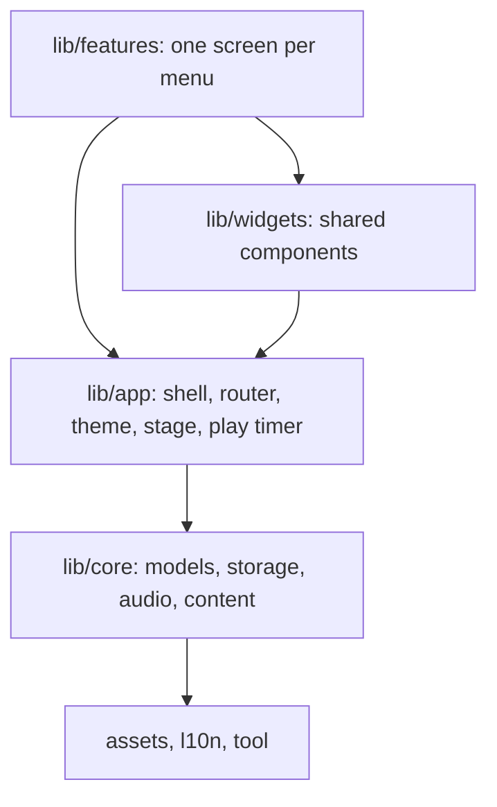

# Moci architecture

This document maps the code that exists: layers, folders, providers, routes, state flows, and the test harness. Product reasoning is in [PRD](docs/PRD.md), the full technical plan is in [TECH-SPEC](docs/TECH-SPEC.md), and content data is in [CONTENT-ASSETS](docs/CONTENT-ASSETS.md).

## 1. Layers

An arrow means depends on. The direction rules:

- `lib/core/` does not import `lib/app/`, `lib/features/`, or `lib/widgets/`. It holds models, storage, audio, and providers.
- `lib/app/` uses `lib/core/`. The only place `lib/app` knows about feature screens is `lib/app/router.dart`.
- `lib/widgets/` uses the theme and stage from `lib/app/`, plus providers from `lib/core/`.
- `lib/features/` may use everything.
- `tool/` runs without Flutter. It imports only the pure models in `lib/core/content/` and `lib/core/lang.dart`.

## 2. Folder map

| Path | Contents |
| --- | --- |
| `lib/main.dart` | `runMoci`: opens storage, loads progress, the asset catalog, and the content catalog, then installs the overrides |
| `lib/app/moci_app.dart` | `MociApp`: `MaterialApp.router`, locale, audio lifecycle, Rest trigger |
| `lib/app/router.dart` | `go_router`, `parentAccessProvider`, `limitReachedProvider`, `currentPathProvider` |
| `lib/app/routes.dart` | Route constants and `routeKindOf` (D14) |
| `lib/app/redirect.dart` | `resolveRedirect`, pure redirect rules without Flutter |
| `lib/app/config.dart` | `AppConfig`: privacy policy URL and support email, still `null` |
| `lib/app/layout/moci_stage.dart` | `MociStage`, `MociLayoutScope`, `MenuThemeScope` |
| `lib/app/layout/device_layout.dart` | `layoutKindFor`, `fitStage`, tablet and phone base sizes |
| `lib/app/theme/` | `MociColors`, `MociText`, `MociSize`, `MociMotion`, `MenuTheme`, `mociTheme` |
| `lib/app/play_timer/` | `PlayTimerState`, `tickPlayTimer`, `PlayTimerController` |
| `lib/app/splash/splash_screen.dart` | Splash |
| `lib/core/content/` | `Katalog`, `TracingSet`, `ColoringSet`, `ContentRepository`, `narasi`, `angkaKata` |
| `lib/core/storage/` | `KeyValueStore`, `JsonStore`, `AppFiles`, `BackupExclusion` |
| `lib/core/prefs/` | `AppPrefs`, `PrefsController` |
| `lib/core/progress/` | `Progress`, `ProgressRepository`, `ProgressController` |
| `lib/core/audio/` | `AudioEngine`, `AudioService`, `Narrator`, `Sfx`, `AssetCatalog`, `DeviceTts` |
| `lib/core/speech/` | `SpeechEngine`, `SpeechToTextEngine`, `kataCocok`, `MicLevelMeter`, `MethodChannelMicLevelMeter` |
| `lib/core/providers.dart` | `clockProvider`, `keyValueStoreProvider`, `jsonStoreProvider` |
| `lib/widgets/` | `MociPressable`, `MociButton`, `MociBackButton`, `MociTopBar`, `MociMascot`, `MociIllustration`, `MociDialog`, `NumberKeypad`, `StarCounter` |
| `lib/widgets/game/` | `GameGlyph`, `GameModePill`, `RouteModePill`, `GameInstruction`, `AnswerCard`, `ProgressDots`, `MicButton`, `RingPulse` |
| `lib/features/beranda/` | Home for tablet and phone, ten menu cards, language switch, stars, parent gate |
| `lib/features/berhitung/` | Counting 1–50: number cards, count together, object grid |
| `lib/features/hadiah/` | Great (Hebat): 30-sticker catalog, round reward |
| `lib/features/huruf/` | Letter Recognition (Kenal Huruf): letter cards, two reading modes, A–Z grid |
| `lib/features/istirahat/` | Rest and Time's Up |
| `lib/features/orang_tua/` | Gate, Parent Area, summary, settings widgets |
| `lib/features/sambutan/` | Welcome (Sambutan): language, name, age |
| `lib/features/hewan/` | Animal World (Dunia Hewan): 42 animals, five groups, facts, real sound or TTS imitation |
| `lib/features/buah_sayur/` | Fruits & Vegetables (Buah & Sayur): Recognize 35 cards and Guess with three rotating choices |
| `lib/features/warna/` | Colors (Warna): 12-card sets, 11 color chips, new picture and other colors |
| `lib/features/bentuk/` | Shapes (Bentuk): Recognize with age levels and corner counting, Find in six rounds |
| `lib/features/musik/` | Music Play (Main Musik): xylophone, drums, `MusikAudio`, song and rhythm rules |
| `lib/features/membaca/` | Let's Read (Ayo Membaca): Syllables, Arrange Words with syllable levels, Sentences with karaoke highlight |
| `lib/features/main_yuk/` | Let's Play! (Main Yuk!): hub and six games, rules in pure Dart `*_game.dart` |
| `lib/features/mewarnai/` | Coloring (Mewarnai): fill and brush engine, Gallery, Canvas, My Artwork, `KaryaRepository` |
| `lib/features/tulis/` | `TracingEngine`, `TracingBoard`, lock grid and crayons, Write Letters and Numbers screens |
| `lib/features/ucapkan/` | Say (Ucapkan): picture words, syllables, mic button, listen and imitate modes |
| `assets/content/katalog.json` | Content catalog, source of truth |
| `assets/tracing/` | `huruf.json` and `angka.json` |
| `assets/coloring/` | `pages.json`, `cap.json`, `krayon.json` |
| `assets/illustrations/` | 111 SVGs, compiled by `vector_graphics_compiler` at build time |
| `assets/fonts/` | Fredoka and Nunito, plus the OFL licenses |
| `assets/audio/` | `LICENSES.csv` for animal sounds and instruments; narration recordings under `vo/` land in Plan 09 |
| `assets/audio/hewan/` | 42 CC0 animal sounds from Freesound, recorded in `assets/audio/LICENSES.csv` |
| `assets/audio/instrumen/` | 12 mono 16-bit 24 kHz WAVs from offline synthesis, license `Milik sendiri` (own work) |
| `l10n/app_id.arb`, `l10n/app_en.arb` | Source of UI text; gen-l10n output lives in `lib/l10n/` |
| `tool/validate_content.dart` | Content validator, also used by CI |
| `tool/konten/` | JS literal parser, one-time prototype export, validation rules |
| `tool/fonts/build_fonts.sh` | Rebuilds the Latin subset fonts |
| `tool/buat_instrumen.dart` | Generator for the 12 xylophone and drum WAVs; the output is committed and never runs while the app runs |
| `test/` | Unit and widget tests, golden tests for three screens only |
| `integration_test/app_test.dart` | Four scenarios on device |
| `.github/workflows/ci.yml` | Test job on Linux and golden job on macOS |

## 3. Providers and their owners

| Provider | File | Contents and owner |
| --- | --- | --- |
| `clockProvider` | `lib/core/providers.dart` | `Clock`. Production uses `SystemClock`, tests use `FakeClock`. |
| `keyValueStoreProvider` | `lib/core/providers.dart` | `KeyValueStore`. No default value; `runMoci` fills it with `SharedPrefsKeyValueStore`, or `TestEnv` with `MemoryKeyValueStore`. |
| `jsonStoreProvider` | `lib/core/providers.dart` | `JsonStore`. Same: `FileJsonStore` or `MemoryJsonStore`. |
| `deviceLocaleProvider` | `lib/core/prefs/prefs_controller.dart` | Device `Locale`, used for the default language. |
| `prefsProvider` | `lib/core/prefs/prefs_controller.dart` | `AppPrefs` and its writer to `shared_preferences`. |
| `initialProgressProvider` | `lib/core/progress/progress_controller.dart` | The `Progress` read from `progress.json` when the app opens. |
| `progressProvider` | `lib/core/progress/progress_controller.dart` | The running `Progress` and the save queue. |
| `katalogProvider` | `lib/core/content/content_repository.dart` | `Katalog`. Filled by `runMoci`, throws if not overridden. |
| `tracingHurufProvider`, `tracingAngkaProvider` | `lib/core/content/content_repository.dart` | `TracingSet` read from `assets/tracing/`; `runMoci` fills them, `TestEnv` uses the same files. |
| `speechEngineProvider` | `lib/core/speech/speech_to_text_engine.dart` | `SpeechToTextEngine` with `onDevice: true`; tests use `FakeSpeechEngine`. |
| `micLevelMeterProvider` | `lib/core/speech/method_channel_mic_level_meter.dart` | `MethodChannelMicLevelMeter` on Android and iOS, `NoopMicLevelMeter` on other platforms; tests use `FakeMicLevelMeter`. |
| `audioEngineProvider` | `lib/core/audio/audio_providers.dart` | `SoLoudAudioEngine`; tests use `FakeAudioEngine`. |
| `assetCatalogProvider` | `lib/core/audio/audio_providers.dart` | `AssetCatalog` from the asset manifest. |
| `deviceTtsProvider` | `lib/core/audio/audio_providers.dart` | `MethodChannelDeviceTts`, used in every build mode. |
| `audioSessionProvider` | `lib/core/audio/audio_providers.dart` | `MethodChannelAudioSession`, iOS playback category. |
| `audioServiceProvider` | `lib/core/audio/audio_providers.dart` | `AudioService`: priority, volume, music ducking. |
| `narratorProvider` | `lib/core/audio/audio_providers.dart` | `Narrator`: recordings first, device TTS as fallback. |
| `audioBootProvider` | `lib/core/audio/audio_providers.dart` | `FutureProvider` that initialises the engine after the first frame. |
| `routerProvider` | `lib/app/router.dart` | `GoRouter`, the route list, and the redirect refresher. |
| `parentAccessProvider` | `lib/app/router.dart` | `bool` for Parent Area access, memory only. |
| `limitReachedProvider` | `lib/app/router.dart` | Derived from `playTimerProvider.limitReached`. |
| `currentPathProvider` | `lib/app/router.dart` | The route actually shown, including `push` results. |
| `playTimerTicksProvider` | `lib/app/play_timer/play_timer_controller.dart` | `Stream<void>` of one-second ticks; tests use a manual stream. |
| `playTimerProvider` | `lib/app/play_timer/play_timer_controller.dart` | `PlayTimerState` and periodic saving. |
| `hadiahProvider`, `hadiahRandomProvider` | `lib/features/hadiah/hadiah_controller.dart` | Round reward and the random source for the sticker picker. |
| `gateRandomProvider` | `lib/features/orang_tua/gerbang_screen.dart` | Random source for the Gate questions. |
| `warnaRandomProvider`, `buahRandomProvider`, `bentukRandomProvider` | `lib/features/warna/warna_screen.dart`, `lib/features/buah_sayur/buah_screen.dart`, `lib/features/bentuk/bentuk_screen.dart` | Random source per screen; tests replace them so card and question order stay fixed. |
| `musikAudioProvider` | `lib/features/musik/musik_audio.dart` | `MusikAudio`: loads the 12 WAVs and plays notes as effects, following the Sound effects switch. |

## 4. Routes and redirects

| Route | Screen |
| --- | --- |
| `/splash` | `SplashScreen` |
| `/sambutan` | `SambutanScreen` |
| `/` | `BerandaScreen` |
| `/huruf` | `HurufScreen`, starting letter from the `huruf` query |
| `/huruf/tulis` | `TulisScreen` letter mode, starting letter from the `huruf` query |
| `/huruf/ucapkan` | `UcapkanScreen`, starting word from the `kata` query |
| `/angka` | `BerhitungScreen`, starting number from the `angka` query |
| `/angka/tulis` | `TulisScreen` number mode, starting number from the `angka` query |
| `/hewan`, `/buah-sayur`, `/warna`, `/bentuk`, `/musik` | `HewanScreen`, `BuahScreen`, `WarnaScreen`, `BentukScreen`, `MusikScreen` |
| `/membaca/suku-kata`, `/membaca/susun-kata`, `/membaca/kalimat` | `SukuKataScreen`, `SusunKataScreen`, `KalimatScreen` |
| `/main`, `/main/cocokkan`, `/main/memori`, `/main/bayangan`, `/main/puzzle`, `/main/balon`, `/main/besar-kecil` | `HubScreen` and the game screens |
| `/mewarnai`, `/mewarnai/:halaman`, `/karyaku` | `GaleriScreen`, `KanvasScreen`, `KaryakuScreen` |
| `/hebat` | `HebatScreen`, requires `HebatArgs` in `state.extra` |
| `/istirahat` | `IstirahatScreen` |
| `/habis` | `HabisScreen` |
| `/gerbang` | `GerbangScreen`, next destination through the `lanjut` query |
| `/orang-tua` | `OrangTuaScreen` |

`resolveRedirect` in `lib/app/redirect.dart` runs in order:

1. `/splash` is never redirected.
2. Welcome not finished: every route redirects to `/sambutan`.
3. Welcome finished and opening `/sambutan`: redirects to `/`.
4. `/orang-tua` without access: redirects to `/gerbang?lanjut=/orang-tua`.
5. Daily limit reached: redirects to `/habis`, except `/habis`, `/gerbang`, and `/orang-tua`.
6. `/habis` while the limit is not reached: redirects to `/`.

A `/hebat` redirect that carries no `HebatArgs` goes back to Home. `PopScope(canPop: false)` wraps `/`, `/splash`, `/sambutan`, `/istirahat`, and `/habis`, so the system back gesture behaves like no back button. Menus open with `push` (D7).

## 5. State flows

**Opening the app.** `runMoci` in `lib/main.dart` registers the font licenses, locks landscape orientation, hides the status bar and the home indicator (`SystemUiMode.immersiveSticky`, plus `UIStatusBarHidden` in `Info.plist`), then opens `SharedPrefsKeyValueStore`, `AppFiles.open` (the `<application support>/moci` folder and backup marker), `FileJsonStore`, `ProgressRepository.load`, `AssetCatalog.load`, and `ContentRepository.loadKatalog`. Those six results become the `ProviderScope` overrides, then `MociApp` runs.

**Audio starts later.** `MociApp` reads `audioBootProvider` in `addPostFrameCallback` so Splash shows without waiting for the audio engine. The order is: playback session category, `AudioEngine.init`, then `preloadSfx`.

**Instruments and animal sounds.** Twelve mono 16-bit 24 kHz WAVs in `assets/audio/instrumen/` are made by `tool/buat_instrumen.dart` and recorded as `Milik sendiri` (own work): no third-party samples and no synthesis while the app runs. `MusikAudio` loads them all once through `AudioEngine`, then plays notes at effect volume 0.7; a note does not stop narration. Animal sounds use `assets/audio/hewan/<id>.m4a` (42 CC0 files). A screen plays only a file that exists in `AssetCatalog`; when it does not exist, the sound imitation from the catalog is read by TTS and the screen never guesses a path.

**Router.** `routerProvider` refreshes when `prefsProvider.onboarded` changes. `limitReachedProvider` also refreshes the router, except while `parentAccessProvider` is open: changing the limit in the Parent Area must not eject the parent. `currentPathProvider` is copied from the last match's `matchedLocation` every time the router delegate reports.

**Language.** `prefsProvider.lang` becomes `MaterialApp.locale`. Switching language does not restart the app; all text comes from `AppLocalizations`.

**Progress.** `ProgressController` applies the change to state, trims play data older than 7 days, then saves through a sequential queue. One failed save does not break the queue.

**Rest and limit.** `PlayTimerController` listens to ticks and `AppLifecycleState`. `MociApp` listens to `playTimerProvider` and `currentPathProvider`, then opens `/istirahat` once per `restDue` when the current route is a play route and the limit has not been reached.

## 6. Test harness and fakes

| File | Contents |
| --- | --- |
| `test/helpers/harness.dart` | `TestEnv`, `pumpScreen`, `pumpApp`, `useScreen`, `tabletSize`, `phoneSize` |
| `test/helpers/fake_audio.dart` | `FakeAudioEngine` and `FakeDeviceTts` |
| `test/helpers/fake_clock.dart` | `FakeClock` |
| `test/helpers/contrast.dart` | `contrastRatio` for contrast tests |
| `test/helpers/katalog.dart` | `katalogUji()` and `envUsia(AgeLevel)`; the age level is written to the `moci.usia` key |
| `test/flutter_test_config.dart` | Loads Fredoka and Nunito for every test |
| `test/helpers/fake_speech.dart` | `FakeSpeechEngine` and `FakeMicLevelMeter` |
| `dart_test.yaml` | Declares the `golden` tag |

`TestEnv` fills `MemoryKeyValueStore`, `MemoryJsonStore`, `FakeClock`, `FakeAudioEngine`, `FakeDeviceTts`, `FakeSpeechEngine`, `FakeMicLevelMeter`, an empty asset catalog, and the content catalog from `assets/content/katalog.json`, read once per process. The age level has no parameter of its own: `envUsia(AgeLevel)` writes `moci.usia` to storage before `TestEnv` is installed. `pumpScreen` installs one screen with the theme, l10n, and fake storage. `pumpApp` installs the whole `MociApp` and returns its router. The fake clock does not advance with `t.pump`, so a test that taps the same widget twice advances `FakeClock` first (the `MociPressable` tap cooldown is 400 ms).

**Shared game components.** `lib/widgets/game/` holds `GameGlyph` (line icon from the artboard), `GameModePill` and `RouteModePill` (mode pills; the second changes route with `pushReplacement`), `GameInstruction`, `AnswerCard`, `ProgressDots`, the 180 pt `MicButton`, and `RingPulse`. The Letter Recognition, Write, Counting, and Say screens use them; do not make a new copy when the next screen needs the same shape.

Golden tests cover only Home, Great, and the Parent Area: `test/features/beranda/beranda_golden_test.dart`, `test/features/hadiah/hebat_golden_test.dart`, and `test/features/orang_tua/orang_tua_golden_test.dart`. The integration test in `integration_test/app_test.dart` uses `runMoci(overrides:)` and never uses `pumpAndSettle`.

## 7. Adding a screen or menu

1. Add the route constant in `lib/app/routes.dart`. If the new route is not a play route, change `routeKindOf` (D14).
2. Register the `GoRoute` in `lib/app/router.dart`. While the screen does not exist yet, use the `_soon` wrapper.
3. Pick a `MenuTheme` for the background and shadow color. Add an enum value in `lib/app/theme/menu_theme.dart` if it does not exist yet.
4. Wrap the screen content in `MociStage`, and provide `phone` only when the phone layout is designed (D12).
5. Add the text to `l10n/app_id.arb` and `l10n/app_en.arb`, copied exactly from the prototype. Mark a sentence that is read aloud with `"description": "narasi"`.
6. If the menu appears on Home, add an entry in `lib/features/beranda/beranda_menu.dart` and a Continue subtitle in `lib/features/beranda/continue_labels.dart`.
7. Record the child's activity through `progressProvider.setLastActivity` and `markItem`, so the Continue card and the Parent Area summary fill in.
8. Write widget tests in `test/features/`. Golden tests only if that screen is Home, Great, or the Parent Area.

## 8. Content plan decisions

| Code | Decision |
| --- | --- |
| K1 | Export only from the `docs/design/prototype` snapshot (14 November 2026). The result is committed, then edited in place. If the canvas design changes, the change is carried into the JSON by hand, not by re-running the export. |
| K2 | Colliding names: `paprika` EN "Bell Pepper" (Arrange Words EN still uses the word "Pepper"); `kado` EN "Gift" (the X letter example EN stays "Box" with a gift picture); `eskrim` "Es Krim" / "Ice Cream". The "Apel Merah" label is not used in Great. |
| K3 | Color ids follow the reduplicated-word pattern in the prototype (`kupu`, `ubur`, `lumba`): `merah muda` becomes `merahmuda`, `abu-abu` becomes `abu`. The id pattern is `^[a-z0-9]+(-[a-z0-9]+)*$` (hyphens allowed, for example `moci-senang`). |
| K4 | Four objects outside the game themes (`hujan`, `onde`, `vas`, `sarang`) go into the `lain` category. Names missing from the prototype are filled in: `hujan` "Hujan"/"Rain", `onde` "Onde-onde"/"Sesame Ball", `vas` "Vas"/"Vase", `sarang` from the Colors data. Match them with the word in `Huruf.dc.html`. |
| K5 | Shapes get `jenis` (`poly`, `round`, `love`, `star`), `sudut` (number of points in `corners`, for a star 5 tips), and `sisi` (= `sudut` for `poly`, 0 for the rest). The prototype has no side field. |
| K6 | Letters are stored per language, because 18 of the 26 letters use a different word and picture. Each letter stores `kata`, `gambar`, `bunyi` (phonics), and `nama` (letter name), matching the prototype columns. |
| K7 | Sentences get `waktu: {id: null, en: null}` until the narration is recorded (Plan 09). While `waktu` is null, the app uses the prototype formula `420 + 75 × word length` ms per word. |
| K8 | Coloring pages use the prototype ids (`kupu`, `ikan`, ..., `hantu`). These ids live in `pages.json`, separate from the catalog ids. Thumbnails are drawn from data, so the thumbnail blob is not exported. The first fourteen pages take `contoh` from the `demo` of `kupu` and the three demo artworks in My Artwork (`ikan`, `rumah`, `pelangi`); ten of them have no example color yet and the validator still warns about them. Thirty new pages (city, sea, fruit, animals, objects) are written by the `tool/konten/halaman_mewarnai/` generator and all of them have `contoh`. |
| K9 | The coloring stickers are called "cap" in code (`assets/coloring/cap.json`), so they are not confused with reward stickers. |
| K10 | One curve in the `dadu` illustration (`M56 54C62 48 70 46 80 46`) gets `fill="none"` at export time. |
| K11 | The music data, the Balloon letter sets, the shape sets per age, and the Puzzle or Big & Small sizes are game rules. They are all written in the feature plan's `*_game.dart` (04 and 06), not in the catalog. |
