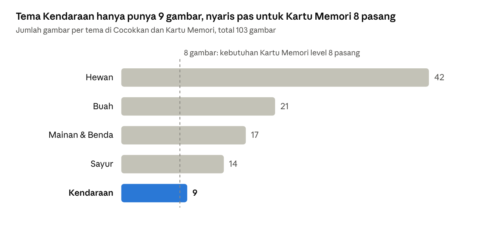

> Salinan dari Claude Docs "Dokumentasi Moci", tab Konten & Aset, per 2026-11-14. Sumber kebenaran: https://claude.ai/artifact/VKF6SyozUj7ZBBCFEQ9e8H.

# Konten & Aset Moci

Isi Moci terdiri dari ilustrasi SVG, katalog JSON, narasi, dan suara, dan semuanya ikut terpasang di aplikasi. Bagian ini mengatur cara membuat, menamai, dan menambah isi tersebut.

## Jumlah gambar per tema



Kartu Memori level 8 pasang mengambil 8 gambar dari satu tema. Dengan hanya 9 kendaraan, permainan bertema Kendaraan hampir selalu memakai gambar yang sama. Menambah beberapa kendaraan, misalnya motor, ambulans, dan traktor, membuat tema itu tidak terasa berulang.

## Aturan ilustrasi SVG

Saat ini ada 116 file SVG ilustrasi dengan total hanya 147 KB, atau rata-rata 1,3 KB per file. Aturan di bawah menjaga gambar baru tetap sekecil dan sekonsisten itu.

### Gambar benda, hewan, buah, sayur, dan kendaraan

- Kanvas `viewBox="0 0 200 200"`, dengan gambar di tengah dan sedikit ruang kosong di tepi.
- Gaya datar dengan bentuk sederhana. Maksimal 12 warna isian per gambar (saat ini median 5).
- Garis tepi 3–7 unit, berwarna tinta `#2B2350` atau versi gelap dari warna isiannya.
- Boleh memakai `opacity` untuk kilau dan bayangan lembut.
- Dilarang memakai `<style>` atau CSS, gradien, gambar raster (`<image>`), teks (`<text>`), filter, dan mask. Semua warna ditulis sebagai atribut, misalnya `fill="#FFD43B"`, karena dukungan CSS di flutter\_svg terbatas.
- Satu file berisi satu benda, tanpa latar. Latar diberikan oleh layar.
- Gambar harus tetap jelas di ukuran sekitar 64 pt, ukuran terkecil di permainan.
- Nama file sama dengan id isinya: huruf kecil tanpa spasi, misalnya `buahnaga.svg` atau `burunghantu.svg`.
- Semua ilustrasi digambar khusus untuk Moci, bukan diambil dari internet, supaya hak ciptanya jelas.

### Halaman mewarnai

- Kanvas 800 × 600. Setiap bagian yang bisa diwarnai adalah satu path tertutup.
- Garis detail seperti mata dan motif disimpan terpisah, lalu digambar di atas semua warna.
- Bagian terkecil sebaiknya minimal 24 unit lebarnya, supaya masih bisa disentuh jari anak.
- Setiap halaman baru punya warna contoh untuk thumbnail di Galeri. Saat ini 44 halaman memakai total 203 KB data; sepuluh halaman prototipe awal belum punya contoh warna.
- Halaman baru ditulis di `tool/konten/halaman_mewarnai/` (bentuk dasar di `bentuk.dart`, per kategori di `kota.dart`, `laut.dart`, `hewan.dart`, `buah.dart`, `benda.dart`). Jalankan `fvm dart run tool/konten/halaman_mewarnai/buat_halaman.dart` untuk menambahkannya ke `pages.json`.

## Format katalog isi

Semua isi yang bisa ditambah tanpa mengubah kode ada di folder `assets/content`, `assets/tracing`, dan `assets/coloring`. Satu entri katalog mewakili satu benda, dan setiap layar menyaring entri sesuai kebutuhannya.

Contoh satu entri di `katalog.json`:

```json
{
  "id": "kucing",
  "kategori": "hewan",
  "nama": { "id": "Kucing", "en": "Cat" },
  "gambar": "illustrations/kucing.svg",
  "warna": "oranye",
  "hewan": {
    "kelompok": "rumah",
    "bunyi": { "id": "Meong!", "en": "Meow!" },
    "fakta": { "id": "Kucing suka tidur dan bermain.", "en": "Cats love to nap and play." }
  },
  "sukuKata": { "id": ["ku", "cing"], "en": null }
}
```

Bagian katalog yang lain:

| Bagian | Isi setiap entri | Jumlah saat ini |
| --- | --- | --- |
| `huruf` | Huruf, contoh kata dua bahasa, id gambar | 26 |
| `angka` | Angka dan id benda untuk dihitung | 50 angka, 12 benda hitung |
| `warna` | Id warna, nama dua bahasa, hex | 11 warna, 81 benda bertanda warna |
| `bentuk` | Nama dua bahasa, jumlah sisi, jumlah sudut | 10 |
| `sukuKata` | Suku kata dan contoh kata | 90 suku kata, contoh untuk 41 |
| `kata` | Kata, pecahan suku kata, id gambar | 71 Bahasa Indonesia, 33 English |
| `kalimat` | Kalimat dua bahasa dan id gambar | 18 |
| `tracing/*.json` | Daftar goresan sebagai path SVG di kotak 520 × 520 | 26 huruf, 10 angka |
| `coloring/pages.json` | Bagian, garis detail, warna contoh, kategori | 44 halaman (862 bagian) |

Semua data awal ini (nama, kelompok hewan, fakta, kata, kalimat, jalur goresan, dan halaman mewarnai) sudah ada di prototipe. Jadi katalog v1 tinggal diekspor ke format di atas.

## Narasi

Semua yang diucapkan Moci direkam suara manusia, bukan dibacakan TTS, supaya pelafalan kedua bahasa jelas dan konsisten. Perkiraan awalnya sekitar 1.200 klip pendek: kurang lebih 650 Bahasa Indonesia dan 550 English.

### Naskah

- Naskah dibuat otomatis dari katalog sebagai satu file CSV berisi nama file, bahasa, teks, dan catatan pelafalan.
- Bunyi huruf (fonik) diucapkan pendek tanpa vokal tambahan, misalnya /b/ dan bukan "be". Nama huruf direkam terpisah.
- Kalimat butuh waktu mulai setiap kata untuk efek karaoke. Waktunya disimpan di katalog sebagai daftar detik, misalnya `[0.0, 0.42, 0.95]`.

### Perekaman

- Satu pengisi suara per bahasa untuk seluruh aplikasi, dengan tempo pelan, jelas, dan hangat.
- Rekam di ruangan sunyi dengan mikrofon yang sama untuk semua sesi.
- Kalau pengisi suara bukan diri sendiri, siapkan surat izin pemakaian suara untuk aplikasi yang dirilis ke publik.

### Format file

| Hal | Nilai |
| --- | --- |
| Rekaman master | WAV 48 kHz, 24-bit, mono. Disimpan di luar repo aplikasi. |
| File di aplikasi | AAC-LC (.m4a) mono, 32 kbps, 24 kHz |
| Kenyaringan | Rata-rata −16 LUFS, puncak maksimal −1 dBTP |
| Hening | Maksimal 50 ms di awal dan 150 ms di akhir |
| Panjang | Kata maksimal 1,5 detik, kalimat maksimal 5 detik |
| Nama file | `vo/<bahasa>/<jenis>_<id>.m4a`, misalnya `vo/id/nama_kucing.m4a` atau `vo/en/fakta_kucing.m4a` |

Dengan format ini, 1.200 klip berdurasi rata-rata 1,5 detik memakan sekitar 7 MB, masih di bawah anggaran audio 12 MB.

## Suara hewan dan efek suara

Suara hewan asli belum ada. Prototipe masih memakai tiruan bunyi yang dibacakan, seperti "Meong!". Untuk v1, 42 suara hewan diambil dari sumber yang lisensinya jelas, dan asal setiap file dicatat.

### Urutan sumber

1. **Rekaman sendiri.** Paling aman untuk hewan yang mudah ditemui, seperti kucing, ayam, bebek, kambing, dan sapi.
2. **Lisensi CC0 (domain publik).** Misalnya dari Freesound dengan filter lisensi Creative Commons 0.
3. **Pixabay.** Boleh dipakai gratis tanpa atribusi, tetapi tidak boleh dibagikan ulang sebagai file berdiri sendiri ([ringkasan lisensi](https://pixabay.com/service/license-summary/)). Pastikan pengunggahnya memang pemilik rekaman.

Hindari lisensi non-komersial (NC), lisensi "hanya untuk pendidikan", dan potongan suara dari video atau film.

Sekitar 12 hewan tidak punya suara khas, misalnya kupu-kupu, semut, ikan, dan ubur-ubur. Untuk hewan seperti ini, buat efek lucu sendiri yang cocok dengan tiruan bunyi di katalog.

### Format

- Suara hewan: AAC (.m4a) mono, maksimal 3 detik, kenyaringan disamakan dengan narasi, di `audio/hewan/<id>.m4a`.
- Efek suara (klik, denting benar, sorakan, balon pecah, kartu dibalik): sekitar 15 file WAV pendek, dibuat sendiri atau CC0.
- Alat musik: 8 nada xilofon dan 4 bunyi drum. Bisa direkam dari alat sungguhan, atau dibuat dengan synthesizer lalu disimpan sebagai WAV.
- Musik latar: satu lagu instrumental pendek yang bisa diulang, komposisi sendiri atau CC0.
- Dua lagu di Main Musik, Twinkle Twinkle dan Mary Had a Little Lamb, adalah melodi tradisional yang sudah domain publik.

### Catatan lisensi

Setiap file audio dari luar dicatat di `assets/audio/LICENSES.csv`, dengan kolom: file, sumber, URL, lisensi, tanggal unduh, dan catatan. Utamakan CC0. Kalau terpaksa memakai lisensi yang meminta atribusi (CC BY), tampilkan kreditnya di Area Orang Tua.

## Aset brand

Semua aset brand final ada di `docs/brand` dalam format PNG dan SVG. Ikon memakai pilihan A (Wajah Moci), splash memakai versi terang, dan logo dipakai bertumpuk atau mendatar sesuai ruang.

| Aset | Kapan dipakai | File di `docs/brand` |
| --- | --- | --- |
| Ikon iOS | Ikon aplikasi di iPhone dan iPad, termasuk mode gelap dan mode tinted | `icon/ios/moci-icon-1024.png`, `-dark-1024`, `-tinted-1024` |
| Ikon adaptif Android | Layer depan dan belakang ikon. Layer monokrom untuk ikon bertema di Android 13 ke atas. | `icon/android/ic_launcher_foreground-1024.png`, `_background-1024`, `_monochrome-1024` |
| Ikon Play Store | Listing di Google Play | `icon/android/play-store-512.png` |
| Logo bertumpuk | Ruang persegi atau tinggi: splash, poster, kartu promosi | `logo/moci-logo-stacked-color.png` |
| Logo mendatar | Ruang lebar dan pendek: header website, banner, kop surat | `logo/moci-logo-horizontal-color.png` |
| Tulisan Moci saja | Saat maskot sudah terlihat di dekatnya, atau di ukuran kecil | `logo/moci-wordmark-color.png` |
| Maskot saja | Stiker, avatar, ikon kecil di dalam aplikasi | `logo/moci-mascot-color.png` |
| Splash iOS dan Android lama | Logo di tengah splash bawaan | `splash/splash-logo.png` (685 × 900) |
| Splash Android 12 ke atas | Ikon untuk SplashScreen API | `splash/splash-icon-android12.png` (1152 × 1152) |
| GitHub | Social preview repo, banner README terang dan gelap, avatar | `github/social-preview.png`, `banner-light.png`, `banner-dark.png`, `avatar.png` |

### Varian warna

- **Warna:** pilihan utama di latar terang.
- **Flat:** tanpa bayangan, untuk ukuran kecil dan cetak.
- **Latar gelap:** untuk latar ungu tua atau hitam.
- **Hitam dan putih:** untuk cetak satu warna, stempel, dan tanda air.

### Aturan pakai

- Sisakan ruang kosong di sekeliling logo, minimal setinggi huruf "o" pada logo.
- Jangan mengubah warna huruf M-o-c-i, memutar logo, menambah gradien atau bayangan baru, atau menaruh logo di atas foto yang ramai.
- Huruf di logo sudah dikonversi jadi bentuk vektor (outline), jadi file SVG tetap tampil sama walau font Fredoka tidak terpasang.

## Cara menambah isi baru

Menambah benda, hewan, atau kata baru tidak butuh perubahan kode. Cukup aset dan satu entri katalog, lalu benda itu otomatis muncul di semua permainan yang memakai kategorinya, seperti Cocokkan, Kartu Memori, Tebak Bayangan, dan Puzzle.

Contoh menambah satu hewan:

1. Gambar ilustrasinya sesuai aturan SVG, lalu simpan sebagai `assets/illustrations/<id>.svg`.
2. Tambahkan entri di `katalog.json`: nama dua bahasa, kategori, warna (kalau warnanya jelas satu), kelompok, tiruan bunyi, dan fakta.
3. Jalankan `dart run tool/validate_content.dart --naskah` untuk membuat daftar narasi yang belum direkam.
4. Rekam narasi dua bahasa sesuai format, lalu simpan di `assets/audio/vo/id` dan `assets/audio/vo/en`.
5. Tambahkan suara asli di `assets/audio/hewan/<id>.m4a`, dan catat asal serta lisensinya di `LICENSES.csv`.
6. Jalankan validasi lagi sampai bersih, lalu cek tampilannya di tablet dan HP.
7. Buka pull request. CI menjalankan validasi yang sama sebelum perubahan digabung.

Halaman mewarnai baru ditulis sebagai bentuk di `tool/konten/halaman_mewarnai/`, lalu `buat_halaman.dart` menambahkannya ke `pages.json`: satu path tertutup untuk setiap bagian yang bisa diwarnai, garis detail terpisah, dan warna contoh untuk thumbnail. Jalur goresan huruf dan angka sudah lengkap, jadi tidak perlu ditambah.
