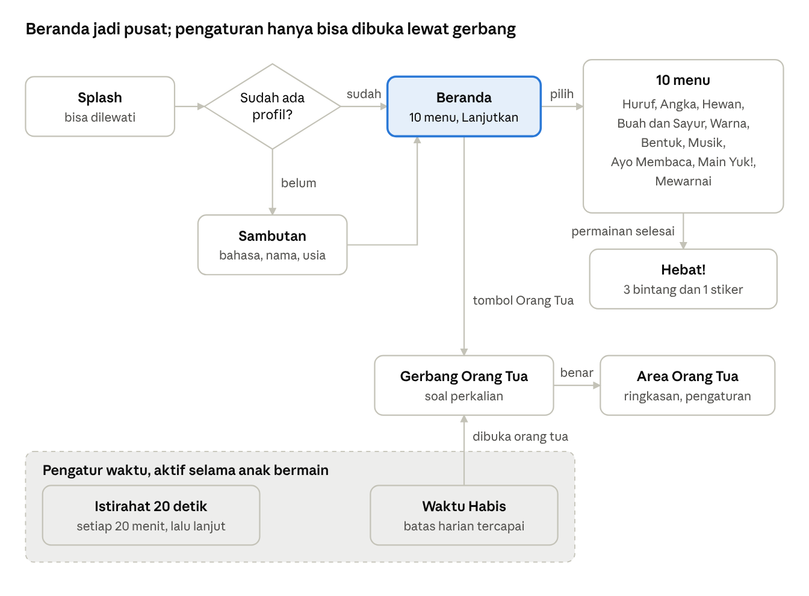

> Salinan dari Claude Docs "Dokumentasi Moci", tab PRD, per 2026-11-14. Sumber kebenaran: https://claude.ai/artifact/VKF6SyozUj7ZBBCFEQ9e8H.

# PRD Moci

Moci v1 berisi 10 menu di Beranda, termasuk 6 mini game di Main Yuk!, ditambah Area Orang Tua. Semuanya berjalan offline dalam Bahasa Indonesia dan English, di tablet maupun HP.

## Tujuan v1

1. Anak 2–7 tahun belajar huruf, angka, membaca awal, dan mengenal dunia sekitar lewat bermain, tanpa perlu bisa membaca instruksi.
2. Orang tua merasa tenang. Tidak ada iklan, pembelian, tautan keluar, atau data yang dikirim ke luar perangkat, dan waktu bermain bisa dibatasi.
3. Aplikasi ringan dan lancar di iPad, iPhone, serta HP dan tablet Android kelas menengah ke bawah.

## Ukuran keberhasilan

Moci tidak memakai analytics. Keberhasilan v1 diukur lewat uji langsung bersama anak, laporan bawaan App Store Connect dan Play Console, serta ulasan di store.

| Ukuran | Target v1 | Cara mengukur |
| --- | --- | --- |
| Anak bermain sendiri | Setiap anak uji menyelesaikan satu permainan tanpa dibantu | Sesi uji 15 menit per anak, minimal satu anak per level usia |
| Tidak ada titik macet | Tidak ada layar tempat anak bingung lebih dari 30 detik | Pengamatan saat sesi uji |
| Stabil | Minimal 99,5% sesi tanpa crash | Xcode Organizer dan Android vitals, tanpa SDK tambahan |
| Ringan | Ukuran unduhan di bawah 30 MB, animasi 60 fps di perangkat uji termurah | Laporan ukuran di App Store Connect dan Play Console, Flutter DevTools |
| Dipercaya orang tua | Rating rata-rata minimal 4,5 | Ulasan di App Store dan Play Store |

## Pengguna

Moci punya dua pengguna: anak yang bermain dan orang tua yang mengatur. Usia anak dipilih orang tua saat pertama membuka aplikasi, dan level usia itu yang menentukan tingkat kesulitan permainan.

| Pengguna | Kondisi | Kebutuhan | Yang disediakan Moci |
| --- | --- | --- | --- |
| Anak 2–3 tahun (level Pemula) | Belum bisa membaca, gerakan jari masih kasar, cepat bosan | Instruksi lewat suara, tombol besar, sedikit pilihan | 3 pilihan jawaban, puzzle 4 keping, 5 bentuk dasar, Balon Huruf dengan 9 huruf |
| Anak 4–5 tahun (level Penjelajah) | Mulai kenal huruf dan angka, suka tantangan kecil | Variasi soal, umpan balik yang jelas | Puzzle 6 keping, 8 bentuk, Balon Huruf dengan 23 huruf |
| Anak 6–7 tahun (level Pembaca) | Mulai membaca suku kata dan kalimat pendek | Tantangan membaca, pilihan lebih banyak | Puzzle 9 keping, 10 bentuk, 4 pilihan di Tebak Bayangan dan Besar & Kecil |
| Orang tua | Ingin aplikasi yang aman, ingin tahu perkembangan anak, ingin membatasi waktu layar | Kontrol yang tidak bisa dibuka anak, ringkasan yang cepat dibaca | Gerbang Orang Tua, Area Orang Tua, batas waktu harian, pengingat istirahat |

## Prinsip produk

Delapan prinsip ini berlaku di semua layar. Kalau ada fitur baru yang melanggar salah satunya, fitur itu harus dirancang ulang.

1. **Suara dulu, teks kedua.** Setiap instruksi dibacakan, dan setiap gambar bisa diketuk untuk didengar. Anak tidak perlu bisa membaca untuk bermain.
2. **Salah tidak dihukum.** Jawaban salah dibalas dengan suara lembut dan ajakan mencoba lagi. Tidak ada nyawa, hitungan mundur, atau skor yang berkurang.
3. **Gerakan sederhana.** Cukup ketuk satu jari atau geser satu jari. Tidak ada ketuk dua kali, tekan lama, atau gerakan dua jari.
4. **Selalu bisa kembali.** Tombol kembali selalu ada di pojok kiri atas, dengan ukuran dan posisi yang sama di setiap layar.
5. **Urusan orang dewasa di balik gerbang.** Pengaturan, tautan keluar, penghapusan data, dan permintaan izin mikrofon hanya bisa dibuka lewat Gerbang Orang Tua.
6. **Offline dan tanpa data keluar.** Semua isi ikut terpasang. Aplikasi tidak butuh internet dan tidak mengirim data apa pun.
7. **Dua bahasa setara.** Semua teks dan suara tersedia dalam Bahasa Indonesia dan English, dan bisa diganti kapan saja.
8. **Kesulitan mengikuti usia.** Jumlah pilihan, keping, dan huruf menyesuaikan level usia di profil anak.

## Alur aplikasi

Anak selalu kembali ke Beranda. Pengaturan dan layar Waktu Habis hanya bisa dilewati lewat Gerbang Orang Tua, sedangkan layar istirahat kembali ke permainan setelah 20 detik.

## Fitur per menu

Semua mekanik di tabel ini sudah ada di prototipe. Kolom terakhir berisi syarat khusus sebelum menu itu dianggap siap rilis.

| Menu | Cara main | Menyesuaikan usia | Syarat siap rilis |
| --- | --- | --- | --- |
| Kenal Huruf | 26 huruf A–Z dengan gambar dan contoh kata. Ketuk untuk mendengar bunyi huruf (fonik) atau nama huruf, sesuai pengaturan orang tua. | Tidak | 26 huruf punya gambar, contoh kata, serta narasi bunyi dan nama dalam dua bahasa |
| Tulis Huruf | Anak menggeser Moci mengikuti panah kuning, goresan demi goresan, sampai ke bintang. | Tidak | 26 huruf punya jalur goresan dengan urutan dan arah yang benar |
| Ucapkan | Dengar contoh kata yang dipecah per suku kata, lalu anak mengucapkannya ke mikrofon dan Moci mendengarkan. | Tidak | Pengenalan ucapan di perangkat untuk semua kata Ucapkan dalam dua bahasa (penjelasan di bawah tabel) |
| Berhitung | Angka 1–50 dalam 5 rentang. "Hitung bareng" menghitung benda satu per satu, atau anak mengetuk benda untuk menghitung sendiri. | Rentang dipilih anak | Narasi angka 1–50 dalam dua bahasa |
| Tulis Angka | Tracing angka 0–9 dengan panduan yang sama seperti huruf. | Tidak | 10 angka punya jalur goresan yang benar |
| Dunia Hewan | 42 hewan dalam 5 kelompok, dengan tombol dengar nama, dengar suara, dan fakta "Tahukah kamu?". | Tidak | Suara asli berlisensi untuk 42 hewan |
| Buah & Sayur | 21 buah dan 14 sayur. Mode Kenali untuk mengenal nama, mode Tebak dengan 3 pilihan gambar. | Tidak | 35 gambar dengan narasi nama dalam dua bahasa |
| Warna | "Sentuh semua yang berwarna merah!" Penghitung menunjukkan berapa yang sudah ketemu. | Tidak | 11 warna, dan 81 gambar sudah ditandai warnanya |
| Bentuk | 10 bentuk berwajah. Mode Kenali menghitung sudut dan sisi. Mode Cari berisi 6 ronde dengan warna yang diacak. | 2–3: 5 bentuk, 3 pilihan. 4–5: 8 bentuk, 4 pilihan. 6–7: 10 bentuk, 6 pilihan | Narasi nama, jumlah sudut, dan jumlah sisi untuk 10 bentuk |
| Main Musik | Xilofon 8 nada dengan mode Dengar dan Ikuti untuk 2 lagu. Drum dengan 4 bunyi dan contoh irama. | Tidak | Bunyi keluar kurang dari 50 ms setelah disentuh |
| Suku Kata | Pilih konsonan untuk membentuk ba-bi-bu-be-bo, ketuk untuk mendengar, lalu lihat contoh katanya. | Tidak | Narasi 90 suku kata (18 konsonan × 5 vokal) |
| Susun Kata | Dengarkan kata, lalu ketuk suku katanya secara berurutan. | Level 2 atau 3 suku kata | 71 kata Bahasa Indonesia dan 33 kata English dengan narasi per suku kata |
| Kalimat | "Baca bersama" menyalakan kata satu per satu seperti karaoke. Ada juga mode Tebak gambar dengan 3 pilihan. | Tidak | 18 kalimat dengan narasi yang selaras per kata |
| Cocokkan Gambar | Hubungkan gambar yang sama dengan mengetuk keduanya atau menarik garis. | 3 sampai 5 pasang, dengan pilihan tema | Garis mengikuti jari tanpa tersendat |
| Kartu Memori | Buka dua kartu dan temukan pasangannya. Jumlah langkah dicatat. | 4, 6, atau 8 pasang | Maksimal dua kartu terbuka bersamaan |
| Tebak Bayangan | "Bayangan siapa ini?" Pilih gambar yang cocok, lalu bayangan berubah jadi berwarna. 6 ronde. | 3 pilihan, atau 4 untuk 6–7 tahun | Bayangan dibuat dari gambar yang sama, tanpa file tambahan |
| Puzzle | Ketuk keping, lalu ketuk tempatnya. | 4, 6, atau 9 keping | Keping dipotong dari ilustrasi yang sudah ada |
| Balon Huruf | Moci menyebut satu huruf, lalu anak memecahkan balon yang cocok. 5 ronde. | 9 huruf untuk 2–3 tahun, 23 huruf untuk usia lain | Balon cukup besar untuk jari anak 2 tahun |
| Besar & Kecil | "Mana yang paling besar?" dan "paling kecil?" bergantian. 6 ronde. | 3 ukuran, atau 4 untuk 6–7 tahun | Selisih ukuran mudah dibedakan |
| Mewarnai | 14 gambar (6 hewan, 8 benda dan alam). Warna tidak bisa keluar garis. Ada kuas 3 ukuran, isi, hapus, stiker, batal, mulai lagi, simpan, dan 16 krayon. | Tidak | Karya tersimpan saat keluar dan bisa dilanjutkan; Karyaku menyimpan 12 karya terakhir |

**Ucapkan di v1 memakai mikrofon.** Izin mikrofon diminta lewat orang tua saat menu ini pertama dibuka. Suara anak dikenali langsung di perangkat, tidak disimpan, dan tidak dikirim ke mana pun. Kalau ucapannya cocok, Moci memuji. Kalau belum, Moci memutar contoh lagi dan mengajak mencoba, paling banyak dua kali, lalu tetap memuji usahanya. Kalau perangkat belum bisa mengenali ucapan secara offline dalam bahasa itu, Moci cukup memastikan anak sudah bersuara. Kalau izin ditolak, Ucapkan tetap bisa dimainkan tanpa mikrofon.

Syarat yang berlaku untuk semua menu:

- Berjalan tanpa internet.
- Semua teks dan narasi tersedia dalam dua bahasa.
- Punya layout tablet dan HP. Desain HP saat ini baru ada untuk Beranda, jadi layar lain didesain dulu sebelum dibangun.
- Permainan yang punya akhir (mode Cari di Bentuk dan 6 mini game) ditutup dengan layar Hebat.

## Fitur pendukung

Fitur-fitur ini menjaga anak tetap aman dan memberi orang tua kendali. Semuanya sudah ada di prototipe, kecuali Hapus semua data yang baru ditambahkan untuk v1.

| Fitur | Cara kerja |
| --- | --- |
| Sambutan | Muncul sekali saat aplikasi pertama dibuka. Orang tua memilih bahasa, mengisi nama panggilan anak, dan memilih usia. Kalau nama dikosongkan, anak disapa "Adik". |
| Splash | Moci jatuh lalu memantul, huruf M-o-c-i muncul satu per satu, lalu aplikasi lanjut sendiri setelah 3,6 detik. Sekali ketuk untuk melewati. |
| Beranda | Sapaan "Hai, nama anak!", 10 menu, tombol Lanjutkan ke kegiatan terakhir, jumlah bintang, pengganti bahasa ID/EN, dan pintu ke Area Orang Tua. |
| Hadiah | Setiap permainan yang selesai memberi 3 bintang dan satu stiker baru untuk Album stiker. |
| Batas waktu harian | Pilihan 15, 30, atau 45 menit, atau tanpa batas. Bawaannya 30 menit. Hitungan direset setiap tengah malam waktu perangkat. Saat habis, muncul layar Waktu Habis yang hanya bisa dibuka orang tua. |
| Pengingat istirahat | Kalau aktif, muncul setiap 20 menit bermain. Layar istirahat 20 detik mengajak anak melihat jauh ke luar jendela, berkedip 10 kali, dan merentangkan tangan. |
| Gerbang Orang Tua | Soal perkalian (angka pertama 6–9, angka kedua 3–9) dijawab lewat papan angka. Gerbang ini melindungi pengaturan, semua tautan keluar, dan permintaan izin mikrofon. |
| Area Orang Tua | Profil anak (nama dan level usia), ringkasan hari ini (waktu bermain, bintang, stiker, karya), perkembangan minggu ini beserta saran latihan, dan pengaturan: bahasa, cara baca huruf, batas waktu, musik latar, efek suara, dan pengingat istirahat. |
| Hapus semua data | Baru untuk v1. Tombol di Area Orang Tua yang menghapus nama, kemajuan, dan karya, lalu membuka Sambutan lagi. |

## Di luar cakupan v1

Hal-hal berikut sengaja tidak masuk v1, supaya rilis pertama tetap kecil dan bisa selesai.

- Akun, login, sinkronisasi antarperangkat, dan cadangan ke cloud.
- Lebih dari satu profil anak dalam satu perangkat.
- Iklan, pembelian dalam aplikasi, dan langganan.
- Isi tambahan yang diunduh dari internet.
- Orientasi potret. Semua layar dikunci di landscape (detailnya di [Spesifikasi Teknis](TECH-SPEC.md)).
- Bahasa selain Bahasa Indonesia dan English.
- Versi web.

Kandidat terkuat untuk versi sesudah v1 adalah profil kedua untuk kakak-adik.
