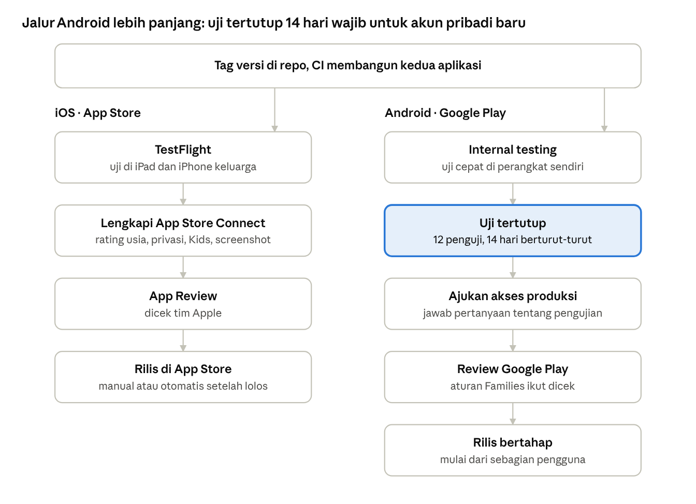

> Salinan dari Claude Docs "Dokumentasi Moci", tab Privasi & Rilis, per 2026-11-14. Sumber kebenaran: https://claude.ai/artifact/VKF6SyozUj7ZBBCFEQ9e8H.

# Privasi & Rilis Moci

Moci tidak mengumpulkan data apa pun. Karena itu, jalur ke kategori anak di App Store dan Google Play jadi paling sederhana: tidak ada data yang perlu dilaporkan, dimintakan izin, atau dihapus dari server. Tab ini bukan nasihat hukum. Bagian regulasi sebaiknya dikonfirmasi ke ahli hukum sebelum rilis.

## Prinsip privasi

- Tidak ada akun, server, analytics, iklan, atau SDK pihak ketiga yang mengirim data.
- Satu-satunya izin perangkat adalah mikrofon untuk menu Ucapkan. Izin ini diminta lewat orang tua, dan suara anak dikenali di perangkat tanpa disimpan atau dikirim. Tidak ada izin kamera, lokasi, kontak, maupun internet.
- Semua tautan keluar, seperti kebijakan privasi, email dukungan, dan halaman store, ada di balik Gerbang Orang Tua.
- Orang tua bisa menghapus semua data lewat Hapus semua data di Area Orang Tua, atau dengan menghapus aplikasi.

| Data | Diisi oleh | Disimpan di | Dikirim keluar |
| --- | --- | --- | --- |
| Nama panggilan anak (boleh kosong) | Orang tua, di Sambutan | Perangkat | Tidak |
| Level usia | Orang tua | Perangkat | Tidak |
| Pengaturan | Orang tua | Perangkat | Tidak |
| Kemajuan, bintang, waktu bermain | Aplikasi | Perangkat | Tidak |
| Karya mewarnai | Anak | Perangkat | Tidak |
| Suara anak di menu Ucapkan | Anak, setelah orang tua memberi izin mikrofon | Tidak disimpan, hanya dikenali sesaat di perangkat | Tidak |

## Draf kebijakan privasi

Kedua store mewajibkan URL kebijakan privasi yang bisa dibuka publik. Draf di bawah siap disalin ke `PRIVACY.md` di repo, lalu dipasang di GitHub Pages kalau repo-nya publik. Isi bagian dalam kurung siku sebelum dipasang.

```markdown
# Kebijakan Privasi Moci

Berlaku sejak: [tanggal rilis]

Moci adalah aplikasi belajar dan bermain untuk anak usia 2–7 tahun. Kami tidak mengumpulkan, menyimpan, atau membagikan data pribadi apa pun.

## Data yang tersimpan di perangkat

Agar aplikasi bisa bekerja, Moci menyimpan hal berikut hanya di perangkat Anda:

- nama panggilan anak (boleh dikosongkan) dan level usia,
- pengaturan seperti bahasa, batas waktu bermain, dan suara,
- kemajuan belajar, bintang, stiker, dan hasil mewarnai.

Data ini tidak pernah dikirim kepada kami atau pihak lain, dan kami tidak bisa melihatnya. Data ini juga tidak ikut dicadangkan otomatis ke layanan cloud.

## Mikrofon

Menu Ucapkan memakai mikrofon supaya anak bisa berlatih mengucapkan kata. Suara anak dikenali langsung di perangkat, tidak direkam ke file, dan tidak dikirim kepada kami atau pihak lain. Izin mikrofon diminta lewat orang tua dan bisa dicabut kapan saja di pengaturan perangkat. Tanpa izin ini, Ucapkan tetap bisa dimainkan tanpa mikrofon.

## Yang tidak kami lakukan

- Tidak ada akun atau login.
- Tidak ada iklan dan pembelian dalam aplikasi.
- Tidak ada analytics, pelacakan, atau SDK pihak ketiga yang mengumpulkan data.
- Tidak memakai internet, kamera, atau lokasi.

## Menghapus data

Buka Area Orang Tua, lalu pilih Hapus semua data. Menghapus aplikasi juga menghapus semua data Moci dari perangkat.

## Anak-anak

Moci dibuat untuk anak dan tidak mengumpulkan data pribadi anak. Pengaturan dan semua tautan keluar dilindungi Gerbang Orang Tua.

## Perubahan kebijakan

Kalau kebijakan ini berubah, versi terbaru dipasang di halaman ini dengan tanggal berlaku yang baru.

## Kontak

Pertanyaan tentang privasi: [email dukungan]
```

```markdown
# Moci Privacy Policy

Effective date: [release date]

Moci is a learning and play app for children aged 2–7. We do not collect, store, or share any personal data.

## Data stored on your device

To work, Moci keeps the following only on your device:

- your child's nickname (optional) and age level,
- settings such as language, daily time limit, and sound,
- learning progress, stars, stickers, and coloring artwork.

This data is never sent to us or anyone else, and we cannot see it. It is not included in automatic cloud backups.

## Microphone

The Ucapkan (Say It) activity uses the microphone so your child can practice saying words. Your child's voice is recognized directly on the device, is never recorded to a file, and is never sent to us or anyone else. Microphone access is requested through a parent and can be turned off at any time in the device settings. Without it, the activity still works without the microphone.

## What we don't do

- No accounts or logins.
- No ads and no in-app purchases.
- No analytics, tracking, or third-party SDKs that collect data.
- No internet, camera, or location access.

## Deleting data

Open Parents' Corner and choose Delete all data. Uninstalling the app also removes all Moci data from the device.

## Children

Moci is made for children and does not collect any personal information from them. Settings and all external links are protected by a parental gate.

## Changes

If this policy changes, the new version will be posted on this page with a new effective date.

## Contact

Privacy questions: [support email]
```

## App Store

Moci didaftarkan di kategori Kids, jadi wajib mengikuti [pedoman 1.3 dan 5.1.4](https://developer.apple.com/app-store/review/guidelines/). Hampir semua syaratnya sudah terpenuhi oleh desain Moci. Satu hal yang masih perlu diputuskan adalah rentang usia.

| Syarat | Status Moci |
| --- | --- |
| Tidak ada tautan keluar, pembelian, atau gangguan bagi anak, kecuali di area yang dilindungi gerbang orang tua (1.3) | Sesuai. Semuanya ada di balik Gerbang Orang Tua. |
| Tidak mengirim data pribadi atau informasi perangkat ke pihak ketiga (1.3) | Sesuai. Tidak ada data yang keluar. |
| Tidak memakai analytics atau iklan pihak ketiga (1.3 dan 5.1.4) | Sesuai |
| Izin mikrofon dan pengenalan ucapan butuh teks alasan di Info.plist (`NSMicrophoneUsageDescription` dan `NSSpeechRecognitionUsageDescription`) | Teks ditujukan untuk orang tua. Dialog izin baru muncul setelah Gerbang Orang Tua. |
| Gerbang orang tua berupa tugas tingkat dewasa. Untuk anak yang belum bisa membaca, Apple menyarankan suara yang mengajak anak memanggil orang tuanya ([Kids apps](https://developer.apple.com/app-store/kids-apps/)). | Soal perkalian sudah ada. Tambahkan narasi "Panggil ayah atau ibu, ya!" saat gerbang dibuka. |
| Pilih satu rentang usia: 5 tahun ke bawah, 6–8, atau 9–11 | Perlu diputuskan, karena Moci untuk usia 2–7 tahun |
| Setelah masuk kategori Kids, aturannya tetap berlaku walau kategori itu dilepas di update berikutnya (1.3) | Catatan untuk masa depan |
| Rating usia memakai sistem baru 4+, 9+, 13+, 16+, dan 18+, dengan kuesioner yang wajib dijawab ([syarat terbaru](https://developer.apple.com/news/upcoming-requirements/)) | Isi Moci tidak mengandung materi yang tidak pantas, jadi diperkirakan mendapat 4+ |
| Label privasi di halaman produk | Pilih bahwa aplikasi tidak mengumpulkan data, sehingga labelnya Data Not Collected. Suara di Ucapkan tidak dihitung, karena data yang hanya diproses di perangkat bukan data yang dikumpulkan ([App Privacy Details](https://developer.apple.com/app-store/app-privacy-details/)). |
| Sejak 28 April 2026, build harus dibuat dengan Xcode 26 dan SDK iOS 26 | CI memakai Xcode 26 atau lebih baru |
| Mulai iOS 27, launch screen wajib ada untuk dikirim ke App Store ([TN3192](https://developer.apple.com/documentation/technotes/tn3192-migrating-your-app-from-the-deprecated-uirequiresfullscreen-key)) | Template iOS Flutter sudah menyertakan launch screen |

Akun Apple Developer Program berbiaya 99 USD per tahun. Kalau mendaftar sebagai individu, nama asli pemilik akun tampil sebagai penjual di App Store. Kalau sebagai organisasi, dibutuhkan badan hukum dan nomor D-U-N-S ([syarat pendaftaran](https://developer.apple.com/support/enrollment/)).

## Google Play

Karena target pengguna Moci anak-anak, aplikasi ini wajib mengikuti [Families Policy](https://support.google.com/googleplay/android-developer/answer/9893335). Hambatan terbesarnya bukan aturan privasi, tetapi uji tertutup 14 hari untuk akun pribadi baru.

| Syarat | Status Moci |
| --- | --- |
| Deklarasikan kelompok usia target di Play Console. Pilih beberapa kelompok hanya kalau aplikasi memang dirancang untuk semuanya. | Usia 2–7 tahun mencakup dua kelompok, jadi keduanya dipilih |
| Kebijakan privasi harus akurat menggambarkan data yang dikumpulkan | Draf di atas |
| Tidak mengirim ID perangkat (AAID, IMEI, dan sejenisnya) dan tidak meminta izin lokasi | Sesuai. Satu-satunya izin adalah mikrofon (`RECORD_AUDIO`) untuk Ucapkan. |
| Tidak meminta izin AD\_ID untuk aplikasi khusus anak yang menargetkan API 33 ke atas | Sesuai |
| Hanya memakai SDK yang disetujui untuk layanan anak | Sesuai. Tidak ada SDK pengumpul data. |
| Isi harus pantas untuk anak | Sesuai |
| Formulir Data safety dan kuesioner rating konten diisi | Data safety: tidak ada data yang dikumpulkan atau dibagikan. Suara di Ucapkan tidak perlu dilaporkan, karena data yang hanya diproses di perangkat tidak dihitung sebagai data yang dikumpulkan ([Data safety](https://support.google.com/googleplay/android-developer/answer/10787469)). |
| Sejak 31 Agustus 2026, aplikasi baru wajib menargetkan Android 16 (API 36) ([syarat target API](https://developer.android.com/google/play/requirements/target-sdk)) | Sudah ada di [Spesifikasi Teknis](TECH-SPEC.md) |
| Akun pribadi yang dibuat setelah 13 November 2023 wajib menjalankan uji tertutup dengan minimal 12 penguji yang ikut terus-menerus selama 14 hari sebelum boleh rilis produksi ([syarat pengujian](https://support.google.com/googleplay/android-developer/answer/14151465)) | Siapkan 12 penguji, misalnya keluarga dan teman yang punya akun Google dan perangkat Android |
| Verifikasi developer Android berlaku di Indonesia sejak 30 September 2026. Developer yang hanya merilis di Google Play cukup memakai akun Play Console ([panduan verifikasi](https://developer.android.com/developer-verification/guides)). | Cek status verifikasi di Play Console |

Biaya pendaftaran Google Play Console adalah 25 USD sekali bayar ([biaya pendaftaran](https://support.google.com/googleplay/android-developer/answer/6112435)).

## Regulasi

Karena Moci tidak mengumpulkan data, sebagian besar kewajiban privasi anak tidak terpicu. Yang tetap perlu dicek adalah PP Tunas, karena Moci memang dirancang untuk anak.

| Aturan | Isi singkat | Dampak ke Moci |
| --- | --- | --- |
| UU 27/2022 tentang Pelindungan Data Pribadi, Pasal 25 ([teks](https://pasal.id/peraturan/uu/uu-no-27-tahun-2022)) | Pemrosesan data pribadi anak wajib mendapat persetujuan orang tua atau wali | Moci tidak memproses data anak di luar perangkat. Nama diisi sendiri oleh orang tua dan tidak pernah sampai ke pengembang. |
| PP 17/2025 tentang pelindungan anak dalam sistem elektronik (PP Tunas), berlaku penuh sejak 28 Maret 2026 setelah transisi satu tahun ([berita](https://investortrust.id/national/98247/meutya-hafid-beberkan-aturan-lengkap-pp-tunas-yang-resmi-berlaku-hari-ini)) | Semua penyelenggara sistem elektronik wajib mematuhinya dan menyampaikan penilaian mandiri profil risiko layanannya ke Komdigi ([Antara](https://jogja.antaranews.com/berita/829868/kemkomdigi-menegaskan-semua-pse-di-indonesia-wajib-mematuhi-pp-tunas)). Komdigi memberi batas penilaian mandiri sampai 31 Desember 2026, dengan aturan pelaksana Permen Komdigi 9/2026 ([Selular](https://selular.id/2026/10/simak-22-platform-digital-berisiko-tinggi-bagi-anak-ada-youtube-hingga-telegram/)). Kewajiban lain mencakup fitur persetujuan orang tua, informasi yang mudah dipahami anak, pelindungan data anak, batasan usia, dan edukasi ([ringkasan](https://siplawfirm.id/resources/implementasi-pelindungan-anak-yang-mengakses-sistem-elektronik-berdasarkan-peraturan-pemerintah-nomor-17-tahun-2025)). | Kemungkinan besar Moci masuk cakupan. Sebagian besar kewajiban sudah terpenuhi lewat Gerbang Orang Tua dan tanpa pengumpulan data, tetapi penilaian mandiri perlu disiapkan sebelum rilis. |
| Aturan negara lain, seperti COPPA di Amerika Serikat dan GDPR di Eropa | Families Policy Google mewajibkan kepatuhan pada aturan seperti ini | Tanpa pengumpulan data, tidak ada persetujuan orang tua yang perlu diminta. Kebijakan privasi tetap menjelaskannya. |

Sebelum rilis, sebaiknya status Moci terhadap PP Tunas dan kewajiban sebagai penyelenggara sistem elektronik dikonfirmasi ke konsultan hukum atau Komdigi.

## Alur rilis



Kedua jalur bisa berjalan bersamaan. Uji tertutup Android sebaiknya dimulai paling awal, karena 14 harinya tidak bisa dipercepat, sementara iOS bisa menyusul setelah TestFlight beres.

## Aset listing store

Screenshot README (1180 × 820) tidak bisa langsung dipakai, karena ukurannya tidak cocok dengan ukuran wajib store. Screenshot listing diambil ulang dari aplikasi Flutter di simulator dan emulator, dalam posisi landscape.

| Aset | App Store ([spesifikasi](https://developer.apple.com/help/app-store-connect/reference/screenshot-specifications/)) | Google Play ([spesifikasi](https://support.google.com/googleplay/android-developer/answer/9866151)) |
| --- | --- | --- |
| Ikon | Dari asset catalog Xcode (`moci-icon-1024.png`) | 512 × 512 PNG 32-bit, maksimal 1 MB (`play-store-512.png`) |
| Grafis utama | Tidak ada | Feature graphic 1024 × 500, JPEG atau PNG tanpa transparansi |
| Screenshot HP | iPhone 6,5 inci landscape 2688 × 1242 atau 2778 × 1284, wajib kalau tidak ada versi 6,9 inci. Versi 6,9 inci (2868 × 1320) opsional. | Minimal 2 screenshot, sisi 320–3840 px, sisi panjang maksimal 2 kali sisi pendek. Untuk masuk rekomendasi: minimal 4 screenshot 16:9 dengan lebar minimal 1920 px. |
| Screenshot tablet | iPad 13 inci landscape 2752 × 2064 atau 2732 × 2048, wajib karena Moci jalan di iPad | Minimal 4 screenshot 16:9, sisi 1080–7680 px |
| Jumlah dan format | 1–10 per ukuran, JPEG atau PNG tanpa transparansi | Maksimal 8 per jenis perangkat |

Teks listing (nama, deskripsi pendek, deskripsi panjang) disiapkan dalam Bahasa Indonesia dan English. Pakai brand dan screenshot yang sama di kedua store supaya tampil konsisten.

## Checklist rilis

Centang setiap butir saat selesai. Urutan di dalam tiap kelompok mengikuti urutan pengerjaan.

### Sebelum build rilis

- [ ] Putuskan rentang usia Kids Category di App Store
- [ ] Buat email dukungan khusus Moci
- [ ] Pasang kebijakan privasi Bahasa Indonesia dan English di URL publik
- [ ] Cek ketersediaan nama Moci di kedua store dan di pangkalan data merek DJKI
- [ ] Daftar Apple Developer Program dan Google Play Console
- [ ] Siapkan penilaian mandiri PP Tunas, atau konfirmasi ke ahli hukum bahwa tidak diperlukan
- [ ] Lengkapi narasi dua bahasa sampai validasi konten bersih
- [ ] Pastikan Hapus semua data berfungsi
- [ ] Pastikan manifest Android hasil gabungan hanya meminta izin RECORD\_AUDIO, tanpa INTERNET dan Bluetooth, dan Info.plist hanya berisi alasan izin mikrofon dan pengenalan ucapan
- [ ] Uji Ucapkan dalam mode pesawat di kedua bahasa, termasuk saat izin mikrofon ditolak

### iOS

- [ ] Build dengan Xcode 26 atau lebih baru
- [ ] Jawab kuesioner rating usia
- [ ] Isi label privasi: aplikasi tidak mengumpulkan data
- [ ] Pilih kategori Kids dan rentang usianya
- [ ] Unggah screenshot iPhone dan iPad 13 inci
- [ ] Uji lewat TestFlight di perangkat keluarga, lalu kirim untuk review

### Android

- [ ] Target API 36
- [ ] Isi target audience dan konten: dua kelompok usia yang mencakup 2–7 tahun
- [ ] Isi Data safety: tidak ada data yang dikumpulkan atau dibagikan
- [ ] Isi kuesioner rating konten
- [ ] Jalankan uji tertutup dengan 12 penguji selama 14 hari berturut-turut (akun pribadi)
- [ ] Cek status verifikasi developer di Play Console
- [ ] Unggah feature graphic, screenshot HP, dan screenshot tablet
- [ ] Ajukan akses produksi, lalu rilis bertahap

## Sumber

Dicek pada 14 November 2026.

- [Apple: App Review Guidelines](https://developer.apple.com/app-store/review/guidelines/)
- [Apple: Kids apps](https://developer.apple.com/app-store/kids-apps/)
- [Apple: Upcoming requirements](https://developer.apple.com/news/upcoming-requirements/)
- [Apple: Screenshot specifications](https://developer.apple.com/help/app-store-connect/reference/screenshot-specifications/)
- [Apple: Enrollment](https://developer.apple.com/support/enrollment/)
- [Apple TN3192: Migrating your app from the deprecated UIRequiresFullScreen key](https://developer.apple.com/documentation/technotes/tn3192-migrating-your-app-from-the-deprecated-uirequiresfullscreen-key)
- [Google Play: Families Policy](https://support.google.com/googleplay/android-developer/answer/9893335)
- [Google Play: App testing requirements for new personal developer accounts](https://support.google.com/googleplay/android-developer/answer/14151465)
- [Google Play: Target API level requirements](https://developer.android.com/google/play/requirements/target-sdk)
- [Google Play: Preview assets](https://support.google.com/googleplay/android-developer/answer/9866151)
- [Google Play: Registration fee](https://support.google.com/googleplay/android-developer/answer/6112435)
- [Android developer verification](https://developer.android.com/developer-verification/guides)
- [UU 27/2022 di Pasal.id](https://pasal.id/peraturan/uu/uu-no-27-tahun-2022)
- [Investortrust: PP Tunas resmi berlaku](https://investortrust.id/national/98247/meutya-hafid-beberkan-aturan-lengkap-pp-tunas-yang-resmi-berlaku-hari-ini)
- [Antara: Semua PSE wajib mematuhi PP Tunas](https://jogja.antaranews.com/berita/829868/kemkomdigi-menegaskan-semua-pse-di-indonesia-wajib-mematuhi-pp-tunas)
- [Selular: Batas penilaian mandiri PP Tunas](https://selular.id/2026/10/simak-22-platform-digital-berisiko-tinggi-bagi-anak-ada-youtube-hingga-telegram/)
- [SIP Law Firm: Kewajiban PSE dalam PP 17/2025](https://siplawfirm.id/resources/implementasi-pelindungan-anak-yang-mengakses-sistem-elektronik-berdasarkan-peraturan-pemerintah-nomor-17-tahun-2025)
- [Apple: App Privacy Details](https://developer.apple.com/app-store/app-privacy-details/)
- [Google Play: Data safety](https://support.google.com/googleplay/android-developer/answer/10787469)
