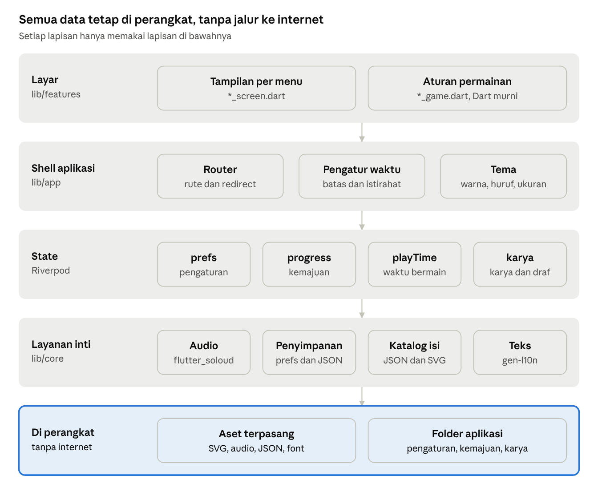

> Salinan dari Claude Docs "Dokumentasi Moci", tab Spesifikasi Teknis, per 2026-11-14. Sumber kebenaran: https://claude.ai/artifact/VKF6SyozUj7ZBBCFEQ9e8H.

# Spesifikasi Teknis Moci

Moci dibangun sebagai satu aplikasi Flutter untuk iOS dan Android yang sepenuhnya offline. Tidak ada server dan tidak ada SDK pihak ketiga yang mengirim data. Semua ilustrasi dan suara ikut terpasang di aplikasi.

## Ringkasan teknologi

| Bagian | Pilihan | Alasan |
| --- | --- | --- |
| Framework | Flutter, dimulai dari versi stabil terbaru (3.50, rilis 11 November 2026) dan dikunci dengan FVM | Satu kode untuk iPad, iPhone, serta HP dan tablet Android |
| Versi OS minimum | iOS dan iPadOS 15, Android 7.0 (API 24) | Batas bawah yang didukung Flutter 3.50 |
| Target Android | API 36 (Android 16) | Wajib untuk aplikasi baru dan update di Google Play sejak 31 Agustus 2026 |
| Ilustrasi | SVG yang dikompilasi saat build dengan `vector_graphics_compiler` | Lebih cepat diurai, dan tidak perlu diproses saat aplikasi berjalan |
| Navigasi | `go_router` | Rute deklaratif, plus redirect untuk Sambutan dan Waktu Habis |
| State | `flutter_riverpod` | Pengaturan, kemajuan, dan pengatur waktu bisa diuji tanpa UI |
| Penyimpanan | `shared_preferences` untuk pengaturan, file JSON di folder aplikasi untuk kemajuan dan karya | Datanya kecil, tidak perlu database |
| Audio | `flutter_soloud` untuk narasi, efek suara, dan alat musik | Latensi rendah, dan bisa memutar M4A, WAV, serta OGG |
| Pengenalan ucapan | `speech_to_text` dalam mode di perangkat (`onDevice`) | Mengenali ucapan anak di menu Ucapkan tanpa mengirim suara keluar |
| Tracing dan mewarnai | `CustomPainter` bawaan Flutter | Tidak perlu paket tambahan |
| Jaringan | Tidak ada | Template Flutter tidak menyertakan izin INTERNET di build rilis Android |
| Crash dan analytics | Tidak ada SDK; pakai Xcode Organizer dan Android vitals | Sesuai aturan aplikasi anak di kedua store |

Paket pihak ketiga dibatasi pada daftar di atas. Paket baru hanya boleh masuk kalau tidak mengirim data, tidak butuh izin tambahan, dan masih aktif dirawat. Versi Flutter dinaikkan sekali per kuartal, setelah rilis barunya berjalan sekitar sebulan.

## Arsitektur



Layar tidak pernah membaca file secara langsung. Semua lewat state dan layanan inti, dan lapisan paling bawah hanya berisi aset terpasang serta folder aplikasi, tanpa koneksi ke luar.

## Struktur proyek

Satu folder per menu di `lib/features`, dan fitur tidak saling meng-import. Semua yang dipakai bersama tinggal di `lib/core` (layanan) dan `lib/widgets` (komponen tampilan).

```text
moci-app/
├── lib/
│   ├── main.dart
│   ├── app/              # MociApp, router, tema, pengatur waktu bermain
│   ├── core/             # audio, penyimpanan, bahasa, pemuat konten
│   ├── widgets/          # tombol, tombol kembali, pil mode, maskot, bintang
│   └── features/
│       ├── beranda/ huruf/ tulis/ ucapkan/ angka/
│       ├── hewan/ buah_sayur/ warna/ bentuk/ musik/
│       ├── membaca/      # suku_kata, susun_kata, kalimat
│       ├── main_yuk/     # cocokkan, memori, bayangan, puzzle, balon, besar_kecil
│       ├── mewarnai/     # galeri, kanvas, karyaku
│       └── sambutan/ hadiah/ istirahat/ orang_tua/
├── assets/
│   ├── illustrations/    # SVG, dikompilasi saat build
│   ├── content/          # katalog.json
│   ├── tracing/          # jalur goresan huruf dan angka
│   ├── coloring/         # halaman mewarnai
│   ├── audio/            # vo/id, vo/en, sfx, instrumen, musik
│   └── fonts/            # Fredoka, Nunito
├── l10n/                 # app_id.arb, app_en.arb
├── tool/                 # skrip validasi konten
├── test/
└── integration_test/
```

Setiap folder menu berisi tiga bagian:

- `*_screen.dart` untuk tampilan.
- `*_game.dart` untuk aturan permainan, ditulis sebagai Dart murni tanpa import Flutter. Bagian ini membuat ronde, menilai jawaban, dan menyesuaikan level usia, dengan `Random` yang bisa diberi seed supaya mudah diuji.
- `widgets/` untuk komponen yang hanya dipakai menu itu.

## Navigasi, state, dan pengatur waktu

Semua layar adalah rute `go_router` di bawah satu shell aplikasi. Shell ini juga menjalankan pengatur waktu bermain, jadi batas harian dan istirahat berlaku di layar mana pun.

### Rute

- Awal: `/splash`, `/sambutan`, `/` (Beranda)
- Huruf dan angka: `/huruf`, `/huruf/tulis`, `/huruf/ucapkan`, `/angka`, `/angka/tulis`
- Dunia sekitar: `/hewan`, `/buah-sayur`, `/warna`, `/bentuk`, `/musik`
- Membaca: `/membaca/suku-kata`, `/membaca/susun-kata`, `/membaca/kalimat`
- Main Yuk!: `/main`, `/main/cocokkan`, `/main/memori`, `/main/bayangan`, `/main/puzzle`, `/main/balon`, `/main/besar-kecil`
- Mewarnai: `/mewarnai`, `/mewarnai/:halaman`, `/karyaku`
- Lainnya: `/hebat`, `/istirahat`, `/habis`, `/gerbang`, `/orang-tua`

Aturan redirect:

1. Belum ada profil: semua rute dialihkan ke `/sambutan`.
2. Batas harian habis: semua rute dialihkan ke `/habis`, kecuali `/gerbang` dan `/orang-tua`.
3. `/orang-tua` hanya bisa dibuka lewat `/gerbang`. Izinnya hilang begitu Area Orang Tua ditutup.

Tombol back sistem di Android berperilaku sama dengan tombol kembali di layar (lewat `PopScope`).

### State

| Provider | Isi |
| --- | --- |
| `prefsProvider` | Pengaturan dari `shared_preferences`. Perubahan langsung berlaku, termasuk ganti bahasa. |
| `progressProvider` | Bintang, stiker, perkembangan per menu, dan kegiatan terakhir untuk tombol Lanjutkan |
| `playTimeProvider` | Waktu bermain hari ini dan status istirahat |
| `karyaProvider` | Daftar karya dan draf mewarnai |

### Pengatur waktu bermain

- Waktu hanya dihitung saat aplikasi terbuka di depan dan anak berada di rute bermain. Gerbang, Area Orang Tua, Istirahat, dan Waktu Habis tidak dihitung.
- Waktu disimpan per tanggal untuk 7 hari terakhir, dan direset setiap tengah malam waktu perangkat.
- Kalau pengingat aktif, setiap 20 menit bermain `/istirahat` dibuka di atas layar yang sedang dipakai. Setelah 20 detik, anak kembali ke layar tadi.
- Saat batas tercapai, rute bermain dialihkan ke `/habis`. Kalau orang tua menaikkan batas, anak bisa langsung lanjut.
- Jam disuntikkan sebagai dependensi (`Clock`), supaya semua aturan ini bisa diuji tanpa menunggu.

## Data dan penyimpanan lokal

Semua data tersimpan di folder aplikasi dan tidak pernah keluar dari perangkat. Dalam kondisi paling penuh (12 karya dan draf untuk 14 halaman), totalnya di bawah 6 MB.

| Data | Tempat | Isi | Batas ukuran |
| --- | --- | --- | --- |
| Pengaturan | `shared_preferences` | Bahasa, nama, level usia, cara baca huruf, batas waktu, musik latar, efek suara, pengingat istirahat, status Sambutan | Di bawah 1 KB |
| Kemajuan | `progress.json` | Bintang, stiker, perkembangan per menu, kegiatan terakhir, waktu bermain 7 hari | Di bawah 50 KB |
| Karya | `karya/<id>.json`, maksimal 12 file | Halaman, warna isian per bagian, coretan, stiker, waktu simpan | Maksimal 200 KB per karya |
| Draf mewarnai | `draf/<halaman>.json`, satu per halaman | Sama seperti karya | Maksimal 200 KB per draf |

Contoh isi `progress.json`:

```json
{
  "versi": 1,
  "bintang": 27,
  "stiker": ["apel", "moci-senang"],
  "kegiatanTerakhir": { "rute": "/huruf/tulis", "param": { "huruf": "A" } },
  "waktuBermain": { "2026-11-14": 1260 },
  "perkembangan": { "huruf": { "dilihat": ["A", "B"], "ditulis": ["A"] } }
}
```

Aturan penyimpanan:

- File ditulis secara atomik: tulis ke file sementara dulu, lalu ganti nama.
- Setiap file punya nomor `versi`. Saat format berubah, aplikasi memigrasi file lama.
- Titik coretan disederhanakan sebelum disimpan, dengan toleransi 1 unit kanvas, supaya karya tetap kecil.
- Cadangan otomatis OS dimatikan: `android:allowBackup="false"` di Android, dan folder data ditandai tidak ikut backup di iOS. Dengan begitu janji "data hanya di perangkat ini" benar apa adanya. Akibatnya, kemajuan tidak ikut pindah saat ganti perangkat.
- Hapus semua data menghapus pengaturan dan semua file, lalu membuka Sambutan lagi.

## Mesin tracing dan mewarnai

Tracing dan mewarnai adalah bagian paling berat di aplikasi. Keduanya digambar dengan `CustomPainter` di dalam `RepaintBoundary`, dan harus tetap 60 fps selama jari bergerak. Angka-angka di bawah ini nilai awal, yang disetel lagi saat uji dengan anak.

### Tracing (Tulis Huruf dan Tulis Angka)

1. Setiap huruf atau angka berupa daftar goresan di kotak 520 × 520, sama seperti prototipe. Urutan goresan dan arah path menentukan cara menulis yang benar.
2. Saat goresan dimulai, path diubah jadi titik-titik berjarak 4 unit lewat `PathMetric`.
3. Jari dianggap berada di jalur kalau jaraknya paling jauh 44 unit dari titik terdekat di depan posisi terakhir.
4. Kemajuan hanya bergerak maju. Gerakan mundur diabaikan, dan lompatan lebih dari 40 unit ke depan ditolak, supaya anak tidak bisa memotong jalan.
5. Goresan selesai saat kemajuan mencapai 97% panjang path. Setelah semua goresan selesai, muncul bintang dan suara pujian.
6. Moci digambar di titik kemajuan, dan panah kuning menunjuk ke arah berikutnya. Jejak yang sudah dilewati diisi pola bintang seperti di prototipe.

### Mewarnai

1. Data halaman berasal dari `pages.json`: kanvas 800 × 600, daftar bagian (path tertutup) beserta garis detailnya, dan warna contoh.
2. Saat jari menyentuh kanvas, aplikasi mencari bagian paling atas yang memuat titik itu dengan `Path.contains`. Bagian itu dikunci sampai jari diangkat, sehingga warna tidak bisa keluar garis.
3. Setiap bagian digambar dengan `canvas.clipPath`: warna isian dulu, lalu coretan. Garis luar digambar paling atas.
4. Coretan yang sudah selesai disimpan sebagai `ui.Picture` per bagian. Setiap frame hanya menggambar ulang coretan yang sedang berlangsung.
5. Kuas punya 3 ukuran. Hapus memakai kuas putih di dalam bagian, dan Isi mengganti warna satu bagian dengan sekali ketuk.
6. Stiker ditempel di titik ketukan dengan ukuran tetap, lalu disimpan sebagai id stiker dan posisinya.
7. Batal menyimpan riwayat sampai 30 langkah, termasuk Mulai lagi. Jadi kanvas yang terhapus tanpa sengaja bisa dikembalikan.
8. Thumbnail di Galeri dan Karyaku digambar dari data karya yang sama, tanpa file gambar tambahan.

Dua permainan lain juga memakai ilustrasi yang sudah ada. Tebak Bayangan memberi `ColorFilter` hitam pada gambar berwarna, dan Puzzle memotong gambar per keping dengan `ClipRect`.

## Audio

Semua suara diputar lewat satu mesin, `flutter_soloud`. Kalau ada yang bertabrakan, prioritasnya narasi dulu, lalu efek suara, lalu musik latar.

| Jenis | Format | Cara dimuat | Aturan |
| --- | --- | --- | --- |
| Narasi | AAC (.m4a), mono | Dimuat saat layar dibuka, dilepas saat layar ditutup | Hanya satu narasi pada satu waktu. Narasi baru menghentikan yang lama. |
| Efek suara | WAV 16-bit, pendek | Dimuat sekali saat aplikasi mulai | Ikut pengaturan Efek suara |
| Alat musik | WAV, 8 nada xilofon dan 4 bunyi drum | Dimuat saat menu Musik dibuka | Bunyi keluar kurang dari 50 ms setelah disentuh |
| Musik latar | OGG, satu loop | Diputar dari file aset | Ikut pengaturan Musik latar. Volume turun saat narasi bicara. |

Volume awal: narasi 100%, efek suara 70%, musik latar 25%. Saat narasi bicara, musik latar turun ke 10%.

Aturan lain:

- Narasi adalah instruksi utama, jadi sesi audio iOS memakai kategori playback. Dengan begitu narasi tetap terdengar walau sakelar senyap aktif, dan volume tetap ikut tombol volume.
- Saat aplikasi pindah ke latar belakang, semua suara berhenti. Saat ada telepon masuk, narasi berhenti dan tidak dilanjutkan otomatis.
- TTS perangkat dipakai di semua mode build untuk teks yang belum direkam, karena rekaman baru masuk di Rencana 09 dan aplikasi disebar lewat sideload. Skrip validasi tetap menggagalkan `--rilis` kalau masih ada teks tanpa rekaman.

### Mikrofon di menu Ucapkan

Ucapkan mendengarkan anak lewat mikrofon, dan semua pengenalan ucapan berjalan di perangkat.

1. Saat Ucapkan pertama dibuka, Gerbang Orang Tua muncul dulu, lalu dialog izin mikrofon dari sistem. Kalau izin ditolak, Ucapkan berjalan dalam mode dengar dan tiru tanpa mikrofon.
2. Pengenalan memakai `speech_to_text` dengan `onDevice: true` dan bahasa sesuai pengaturan. Kata target dikirim sebagai `contextualPhrases` ([speech\_to\_text](https://pub.dev/packages/speech_to_text)).
3. Satu giliran mendengar paling lama 4 detik. Selama mendengar, narasi dan musik dihentikan supaya tidak ikut terekam. Setelah giliran selesai, sesi audio kembali ke mode pemutaran.
4. Ucapan dianggap cocok kalau salah satu hasil pengenalan, setelah diubah ke huruf kecil tanpa tanda baca, sama dengan kata target. Untuk kata 4 huruf atau lebih, selisih satu huruf masih diterima.
5. Kalau pengenalan di perangkat tidak tersedia untuk bahasa itu, aplikasi hanya memeriksa level suara. Anak dianggap sudah bicara kalau suaranya di atas ambang selama minimal 0,3 detik.
6. Suara anak tidak pernah ditulis ke file dan tidak dikirim ke mana pun.
7. Android cukup memakai izin `RECORD_AUDIO` dan blok `<queries>` untuk `android.speech.RecognitionService`. README plugin juga meminta izin INTERNET karena pengenalan bisa memakai layanan jarak jauh. Moci hanya memakai mode di perangkat, jadi izin INTERNET dan Bluetooth tidak ditambahkan, dan Ucapkan diuji dalam mode pesawat.
8. iOS butuh `NSMicrophoneUsageDescription` dan `NSSpeechRecognitionUsageDescription` di Info.plist, dengan teks yang ditujukan untuk orang tua.

## Dua bahasa, layout, dan aksesibilitas

### Dua bahasa

- Teks UI memakai `gen-l10n` bawaan Flutter dengan dua file, `app_id.arb` dan `app_en.arb`.
- Nama dan fakta isi (hewan, buah, kata, kalimat) ada di `katalog.json`, satu kolom per bahasa.
- Narasi ada di `audio/vo/id` dan `audio/vo/en` dengan nama file yang sama.
- Bahasa bisa diganti kapan saja dari Beranda atau Area Orang Tua, tanpa memulai ulang aplikasi. Pilihan otomatis mengikuti bahasa perangkat: Bahasa Indonesia untuk perangkat berbahasa Indonesia, English untuk lainnya.

### Layout tablet dan HP

- Semua layar dirancang landscape dengan dua ukuran dasar: tablet 1180 × 820 pt dan HP 844 × 390 pt, sama seperti prototipe.
- Layout tablet dipakai kalau sisi terpendek layar 600 dp atau lebih. Selain itu, aplikasi memakai layout HP.
- Isi layar diskalakan proporsional dari ukuran dasar ke area aman yang tersedia. Sisa ruang diisi warna latar menu, jadi tidak ada bagian yang terpotong.
- **Orientasi dikunci landscape** (kiri dan kanan) di semua perangkat, lewat `SystemChrome.setPreferredOrientations` dengan `landscapeLeft` dan `landscapeRight` saat aplikasi mulai.
- iOS: `UISupportedInterfaceOrientations` untuk iPhone dan iPad hanya berisi landscape kiri dan kanan, dan Requires full screen (`UIRequiresFullScreen`) diaktifkan. Di iPad, kunci orientasi hanya dihormati kalau multitasking dimatikan ([Flutter](https://api.flutter.dev/flutter/services/SystemChrome/setPreferredOrientations.html)).
- Android: `android:screenOrientation="sensorLandscape"` di activity utama. Android 16 mengabaikan kunci ini di layar dengan lebar terkecil 600 dp ke atas untuk aplikasi yang menargetkan API 36, jadi tambahkan properti `android.window.PROPERTY_COMPAT_ALLOW_RESTRICTED_RESIZABILITY` bernilai `true` di `<application>` ([Android 16](https://developer.android.com/about/versions/16/behavior-changes-16)).
- Kunci ini makin sulit dipertahankan ke depan. Opt-out Android tidak berlaku lagi saat Moci menargetkan API 37 ([Android 17](https://developer.android.com/about/versions/17/changes/ff-restrictions-ignored)), dan pengecualian tetapnya hanya untuk aplikasi yang dikategorikan sebagai game lewat `android:appCategory`. Mulai SDK iOS 27, `UIRequiresFullScreen` juga tidak lagi mencegah jendela iPad diubah ukurannya ([TN3192](https://developer.apple.com/documentation/technotes/tn3192-migrating-your-app-from-the-deprecated-uirequiresfullscreen-key)). Karena itu, tampilan yang diskalakan tetap disiapkan sebagai cadangan kalau OS mengabaikan kunci.

### Aksesibilitas

- Setiap tombol bergambar punya label `Semantics` dalam bahasa yang aktif, seperti `aria-label` di prototipe.
- Kalau perangkat meminta animasi dikurangi (`MediaQuery.disableAnimations`), animasi hiasan dimatikan. Umpan balik benar dan salah tetap muncul.
- Teks punya kontras minimal 4,5 : 1 terhadap latarnya.
- Di layar permainan, ukuran teks tidak ikut pengaturan huruf sistem supaya tata letak tidak pecah. Di Area Orang Tua, teks ikut pengaturan sistem sampai 1,3 kali.

## Anggaran performa dan ukuran

Target utamanya ukuran unduhan di bawah 30 MB dan animasi 60 fps di perangkat uji termurah. Anggaran ini dicek di setiap rilis, bukan hanya di akhir.

| Hal | Anggaran | Cara cek |
| --- | --- | --- |
| Ukuran unduhan per perangkat | Di bawah 30 MB | Laporan ukuran di App Store Connect dan Play Console |
| Kode dan engine Flutter | Maksimal 12 MB | `flutter build appbundle --analyze-size` dan `flutter build ipa --analyze-size` |
| Ilustrasi (SVG terkompilasi) | Maksimal 4 MB | Skrip validasi konten |
| Audio | Maksimal 12 MB | Skrip validasi konten |
| Font | Maksimal 1 MB | Hanya subset huruf Latin |
| Waktu buka sampai splash bergerak | Di bawah 1,5 detik | Diukur di perangkat termurah, build rilis |
| Frame | 60 fps tanpa tersendat saat tracing dan mewarnai | Flutter DevTools, mode profile |
| Memori | Di bawah 200 MB | DevTools dan profiler bawaan Xcode atau Android Studio |
| Latensi alat musik | Di bawah 50 ms | Rekaman video gerak lambat saat mengetuk |

Perangkat uji minimal:

- 1 iPad lama yang masih menjalankan iPadOS 15 atau 16
- 1 iPhone berlayar kecil
- 1 HP Android dengan RAM 3 GB
- 1 tablet Android 8–10 inci dengan RAM 2–3 GB

## Pengujian, build, dan CI

Setiap pull request menjalankan analisis, tes, dan validasi konten. Setiap tag versi membangun file rilis untuk kedua store.

### Pengujian

| Jenis | Yang dites |
| --- | --- |
| Unit | Aturan setiap permainan (ronde, penilaian, level usia), algoritma tracing, hit-test mewarnai, pengatur waktu dengan jam palsu, migrasi file data |
| Widget | Setiap layar tampil benar dalam dua bahasa dan dua layout (tablet dan HP) |
| Golden | Beranda, Hebat, dan Area Orang Tua dibandingkan dengan gambar acuan |
| Integrasi | Alur pertama kali (Sambutan, Beranda, satu permainan, Hebat), Gerbang Orang Tua, dan batas waktu |
| Validasi konten | Setiap entri katalog punya SVG, nama dua bahasa, dan narasi dua bahasa. SVG mengikuti aturan, dan ukuran folder sesuai anggaran. |
| Uji dengan anak | Sesi 15 menit per anak sebelum setiap rilis besar, sesuai ukuran keberhasilan di [PRD](PRD.md) |

### Build dan CI

1. Setiap pull request menjalankan `flutter analyze`, `flutter test`, dan `dart run tool/validate_content.dart` di GitHub Actions.
2. Setiap tag `v*` membangun `appbundle` untuk Android dan `ipa` untuk iOS, lalu mengunggahnya ke Play internal testing dan TestFlight.
3. Build iOS butuh macOS dan Xcode. Kalau tidak punya Mac, pakai runner macOS di GitHub Actions atau layanan seperti Codemagic.
4. Kunci tanda tangan (keystore Android dan sertifikat Apple) disimpan di GitHub Secrets, tidak pernah masuk repo.
5. Nomor versi diambil dari `pubspec.yaml`, misalnya `1.0.0+1` (versi dan nomor build).

## Sumber

Dicek pada 14 November 2026.

- [Flutter: Supported deployment platforms](https://docs.flutter.dev/reference/supported-platforms)
- [Flutter: What's new, rilis 3.50](https://docs.flutter.dev/release/whats-new)
- [Flutter: Build and release an Android app](https://docs.flutter.dev/deployment/android)
- [flutter\_soloud di pub.dev](https://pub.dev/packages/flutter_soloud)
- [flutter\_svg di pub.dev](https://pub.dev/packages/flutter_svg)
- [Apple TN3192: Migrating your app from the deprecated UIRequiresFullScreen key](https://developer.apple.com/documentation/technotes/tn3192-migrating-your-app-from-the-deprecated-uirequiresfullscreen-key)
- [Android: App orientation, aspect ratio, and resizability](https://developer.android.com/develop/adaptive-apps/guides/app-orientation-aspect-ratio-resizability)
- [Android 17: Restrictions on orientation and resizability are ignored](https://developer.android.com/about/versions/17/changes/ff-restrictions-ignored)
- [Google Play: Target API level requirements](https://developer.android.com/google/play/requirements/target-sdk)
- [speech\_to\_text di pub.dev](https://pub.dev/packages/speech_to_text)
- [Flutter: SystemChrome.setPreferredOrientations](https://api.flutter.dev/flutter/services/SystemChrome/setPreferredOrientations.html)
- [Android 16: Behavior changes](https://developer.android.com/about/versions/16/behavior-changes-16)
