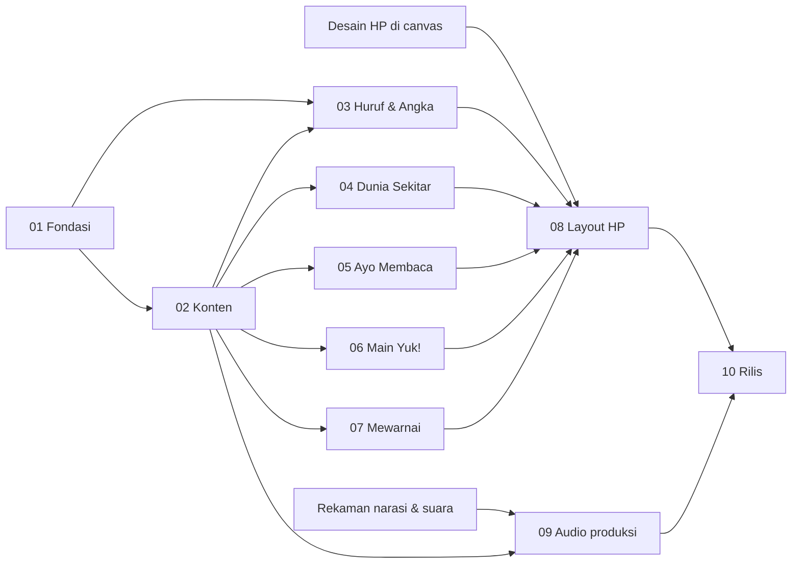

# Moci v1 — Roadmap Implementasi

Moci v1 dibangun lewat 10 rencana berurutan. Rencana 01 (Fondasi) dan 02 (Konten) sudah ditulis lengkap dan siap dieksekusi. Rencana lain ditulis saat gilirannya tiba, supaya bisa memakai nama dan antarmuka yang benar-benar dihasilkan rencana sebelumnya. Dokumen ini memetakan isi, urutan, dan ketergantungan semua rencana, beserta keputusan yang masih perlu kamu ambil.

**Sumber:**
- Spec: [Dokumentasi Moci](https://claude.ai/artifact/VKF6SyozUj7ZBBCFEQ9e8H), tab Ringkasan, PRD, Spesifikasi Teknis, Sistem Desain, Konten & Aset, dan Privasi & Rilis.
- Desain: [canvas Moci](https://claude.ai/artifact/SaDuEPgwdFp5WSfoAhvum8). Snapshot per 14 November 2026 ada di `docs/design/prototype/` (40 artboard, `canvas.json`, dan 172 aset di `assets/`).
- Suara hewan: `docs/audio/SUARA-HEWAN.md`.

## Urutan rencana

| # | Rencana | Isi | Butuh | Berkas |
| --- | --- | --- | --- | --- |
| 01 | Fondasi | Proyek Flutter 3.50, tema, panggung layout, penyimpanan, audio, dua bahasa, router, splash, Sambutan, Beranda tablet dan HP, Gerbang, Area Orang Tua, pengatur waktu, Hebat, CI | — | `2026-11-14-moci-01-fondasi.md` (siap) |
| 02 | Konten | Ekspor data prototipe ke `assets/content/katalog.json`, `assets/tracing/`, dan `assets/coloring/`. Ekspor 110 SVG. Model konten Dart murni dan pemuatnya. `tool/validate_content.dart` (dengan `--naskah` dan `--rilis`), `assets/audio/LICENSES.csv`, dan langkah CI | 01 Task 1, 5, 10 | `2026-11-14-moci-02-konten.md` (siap) |
| 03 | Huruf & Angka | Kenal Huruf (fonik atau nama huruf), mesin tracing, Tulis Huruf dan Tulis Angka, Ucapkan (mikrofon di perangkat), Berhitung 1–50 | 01, 02 | belum ditulis |
| 04 | Dunia Sekitar | Dunia Hewan (42 hewan, 5 kelompok), Buah & Sayur (Kenali dan Tebak), Warna (11), Bentuk (Kenali, dan Cari yang berakhir di Hebat), Main Musik (xilofon dan drum) | 01, 02 | belum ditulis |
| 05 | Ayo Membaca | Suku Kata (18 × 5), Susun Kata (71 ID dan 33 EN, level 2 dan 3 suku kata), Kalimat (18 kalimat, efek karaoke) | 01, 02 | belum ditulis |
| 06 | Main Yuk! | Hub dan 6 permainan dengan level usia, hadiah lewat `finishGame`, uji integrasi "satu permainan → Hebat" | 01, 02 | belum ditulis |
| 07 | Mewarnai | Mesin mewarnai, Galeri 14 halaman, Kanvas (kuas 3 ukuran, isi, hapus, stiker, batal 30 langkah, 16 krayon), Karyaku (12 karya), draf | 01, 02 | belum ditulis |
| 08 | Layout HP | Layout 844 × 390 untuk semua layar selain Splash dan Beranda | desain HP di canvas, 03–07 | belum ditulis |
| 09 | Audio produksi | Sekitar 1.200 klip narasi, naskah CSV, pipeline ffmpeg (suara hewan, efek, alat musik), musik latar, validasi rilis tanpa TTS | 02, rekaman | belum ditulis |
| 10 | Rilis | CI tag `v*` ke TestFlight dan Play internal testing, signing, kebijakan privasi publik, URL di `AppConfig`, listing dan screenshot, checklist store, PP Tunas | semua | belum ditulis |

Dokumentasi repo (`AGENTS.md`, `CLAUDE.md`, `ARCHITECTURE.md`, `SYSTEM_DESIGN.md`, `DESIGN.md`, `CONTRIBUTING.md`, `LICENSE`, `.gitignore`, `README.md`, dan salinan spec di `docs/`) punya rencana sendiri di `2026-11-14-moci-dokumentasi-repo.md`. Rencana itu dijalankan setelah 01 dan 02.

**Yang bisa berjalan paralel:**
- **Rencana 02** bisa mulai setelah Task 1, 5, dan 10 Rencana 01 selesai, lalu berjalan bersamaan dengan sisa Rencana 01.
- **Rencana 03–07** menyentuh folder fitur masing-masing. Komponen permainan bersama (pil mode, kotak instruksi, kartu jawaban, titik kemajuan, tombol mikrofon) dibuat oleh Rencana 03 karena di sanalah komponen itu pertama dipakai. Jadi jalankan 03 lebih dulu, baru 04–07 boleh paralel.
- **Jalur non-kode** sebaiknya dimulai sekarang: desain HP, rekaman narasi, suara hewan, akun developer, dan kebijakan privasi. Uji tertutup Google Play butuh 14 hari dan tidak bisa dipercepat.

## Keputusan yang perlu kamu ambil

Setiap butir punya default yang sudah dipakai di Rencana 01. Ganti kalau tidak setuju.

| # | Keputusan | Default sekarang | Mengunci apa |
| --- | --- | --- | --- |
| 1 | Bundle id dan application id | `id.pandudpn.moci` | Tidak bisa diubah setelah unggahan pertama ke store |
| 2 | Sumber suara hewan | **Diputuskan 14 November 2026:** Freesound CC0 saja, aman di repo publik. Rekaman sendiri hanya kalau tidak ada yang cocok. Tanpa Pixabay dan tanpa CC BY | Rencana 02 (validator) dan 09 |
| 3 | Katalog 30 stiker | 6 per tema: hewan, buah, sayur, kendaraan, benda (tabel di Rencana 01 Task 10) | Hebat dan album |
| 4 | Ringkasan "Minggu ini" dan teks saran di Area Orang Tua | Item berbeda 7 hari terakhir dibagi total isi modul; saran = modul dengan cakupan terendah, dengan teks baru | Rencana 01 Task 18 dan pencatatan di 03–07 |
| 5 | Istirahat selesai | Kembali otomatis setelah 20 detik (spec). Prototipe memakai tombol "Lanjut main" | Rencana 01 Task 16 |
| 6 | Siapa yang mendesain layout HP untuk 28 layar | Belum ada. Saya bisa membuatnya di canvas memakai pola Beranda HP | Rencana 08 dan rilis |
| 7 | Pengisi suara narasi ID dan EN | Pertanyaan terbuka di spec | Rencana 09 dan semua build rilis |
| 8 | URL kebijakan privasi dan email dukungan | Pertanyaan terbuka di spec | Rencana 10 |
| 9 | Rentang usia Kids Category App Store (5 tahun ke bawah, atau 6–8) | Pertanyaan terbuka di spec | Rencana 10 |
| 10 | Harga, akun developer pribadi atau badan usaha, cek nama "Moci" di DJKI | Pertanyaan terbuka di spec | Rencana 10 |

## Temuan dari pengecekan spec dan prototipe

**Teknologi (dicek 14 November 2026):**
- **Material dipisah dari framework.** Flutter 3.50 men-deprecate `package:flutter/material.dart` dan menggantinya dengan paket `material_ui` ([breaking change](https://docs.flutter.dev/release/breaking-changes/material-ui-and-cupertino-ui)). Rencana 01 memakai import baru sejak task pertama.
- **Audio:** `flutter_soloud` 5.3 memutar M4A lewat decoder native iOS dan Android, jadi format narasi di spec aman ([pub.dev](https://pub.dev/packages/flutter_soloud)). Paket ini tidak mendokumentasikan kategori sesi audio iOS, jadi kategori playback (supaya narasi tetap terdengar walau sakelar senyap aktif) disetel lewat kanal native kecil.
- **Pengenalan ucapan:** `speech_to_text` 7.5 punya `SpeechListenOptions.onDevice`, `contextualPhrases`, dan `onSoundLevelChange` ([API](https://pub.dev/documentation/speech_to_text/latest/speech_to_text/SpeechListenOptions-class.html)), jadi rancangan Ucapkan bisa dijalankan. Dua hal untuk Rencana 03:
  - Pastikan mode on-device di Android tidak diam-diam memakai layanan jaringan. Uji di mode pesawat, dan cek perilakunya saat ada internet.
  - Fallback "cek level suara" untuk perangkat tanpa pengenalan offline butuh pengukur mikrofon native kecil, karena memanggil `speech_to_text` tanpa `onDevice` bisa mengirim suara ke server.
- **Paket tambahan.** Spec tidak menyebut `path_provider` (folder aplikasi) dan `url_launcher` (tautan di balik gerbang). Keduanya paket first-party flutter.dev yang tidak mengirim data.

**Prototipe dibanding spec:**

| Hal | Prototipe | Spec | Dipakai |
| --- | --- | --- | --- |
| Sambutan | Muncul setiap kali aplikasi dibuka | Hanya sekali | Spec, dengan flag |
| Bahasa awal | Selalu `id` | Ikut bahasa perangkat | Spec |
| Bintang, stiker, waktu bermain, "Lanjutkan" | Angka statis, atau hanya di memori | Tersimpan di `progress.json` | Spec, dengan field `harian` tambahan |
| Navigasi | Tanpa back stack; tombol kembali menuju layar tetap | Back sistem sama dengan tombol kembali | Push untuk menu, `PopScope` di layar terkunci |
| Gerbang | Soal awal tetap (7 × 6, angka 4 sudah terisi); tanpa narasi saat dibuka | Narasi "Panggil ayah atau ibu" saat dibuka | Soal acak; narasi dari teks prototipe ("Ayah atau Bunda") |
| Tombol angka gerbang | 96 × 84, radius 24 | 88 pt, radius 28 | Prototipe. Angka 88 adalah ubin gembok |
| Istirahat | Tombol "Lanjut main"; hanya langkah 1 yang dibacakan | Kembali setelah 20 detik; suara dulu | Spec |
| Hadiah | Tanpa katalog stiker; "Main lagi" selalu ke hub | Satu stiker baru per permainan | Katalog 30; "Main lagi" ke permainan tadi |
| Area Orang Tua | Angka contoh; musik dan efek tidak berpengaruh | Ringkasan nyata | Ringkasan dari data nyata (keputusan 4) |
| Layout HP | Hanya Beranda, dan tidak tersambung | Semua layar punya layout HP | Desain dulu (keputusan 6) |

**Isi prototipe dibanding tab Konten & Aset** (rincian di `docs/design/notes/inventaris-konten.md`):

| Hal | Dokumen | Prototipe | Penanganan |
| --- | --- | --- | --- |
| Ilustrasi | 116 file, ~147 KB | 107 file isi (147 KB), semua lolos aturan SVG, ditambah 3 gambar UI | Rencana 02 mengekspor 110 file |
| Huruf | 26 huruf dengan contoh kata dua bahasa | Dua daftar terpisah: 18 dari 26 huruf memakai kata dan gambar berbeda per bahasa | Disimpan per bahasa (K6) |
| Bentuk | Jumlah sisi dan sudut | Hanya titik sudut, tanpa field sisi | Field `sisi`, `sudut`, dan `jenis` ditambahkan (K5) |
| Kalimat | Waktu mulai tiap kata | Tidak ada; dihitung `420 + 75 × panjang kata` ms | Field `waktu` null sampai narasi direkam (K7) |
| Warna contoh halaman mewarnai | Setiap halaman | Hanya 4 dari 14 (termasuk karya demo) | Pekerjaan desain untuk 10 halaman |
| Nama yang bentrok | — | `paprika`, `kado`, `eskrim`, id warna berspasi | Diseragamkan (K2, K3) |
| Ucapkan | Semua kata dalam dua bahasa | 5 kata per bahasa | Diekspor apa adanya |
| Suara hewan, efek, alat musik | File audio | Belum ada; prototipe memakai TTS dan synthesizer | Rencana 09 |

**Pekerjaan desain dan konten di luar kode** (bisa mulai sekarang, paralel dengan kode):
1. Layout HP untuk 28 layar di canvas. Polanya diturunkan dari Beranda HP: kartu ×0,66, kontrol bilah atas ×0,75, inset samping 44, tanpa tagline dan subjudul.
2. Warna contoh untuk 10 halaman mewarnai.
3. Opsional: tambah ilustrasi kendaraan (misalnya motor, ambulans, traktor), seperti saran tab Konten & Aset, karena tema Kendaraan baru punya 9 gambar.
4. Rekaman narasi sesuai `build/naskah.csv` hasil Rencana 02.
5. Suara 42 hewan (`docs/audio/SUARA-HEWAN.md`), sekitar 15 efek suara, 8 nada xilofon dan 4 bunyi drum, dan satu musik latar.

**Hal lain:**
- **Narasi rekaman tidak bisa menyebut nama anak.** Kalimat seperti "Hai, Raka! Aku Moci…" dibacakan dalam varian tanpa nama, sementara layar tetap menampilkan nama.
- **Repo ini publik.** Snapshot desain, ilustrasi, dan audio yang di-commit akan ikut publik saat di-push. Lisensi "all rights reserved" di README tetap berlaku untuk karya sendiri. Suara hewan memakai Freesound CC0, yang boleh disebarkan di repo publik (lihat `docs/audio/SUARA-HEWAN.md`).
- **Ekspor dokumentasi ke repo.** Tab Ringkasan menyarankan ekspor setiap tab ke `docs/PRD.md`, `docs/TECH-SPEC.md`, `docs/DESIGN-SYSTEM.md`, `docs/CONTENT-ASSETS.md`, dan `docs/PRIVACY-RELEASE.md`. Caranya lewat menu Export → Markdown di Claude Docs. Dengan begitu spec ikut tersimpan bersama kode, dan agen pelaksana bisa membacanya tanpa akses ke Claude Docs.

## Definisi selesai v1

v1 selesai kalau semua butir di bawah terpenuhi. Daftarnya diambil dari "Syarat siap rilis" di PRD, ditambah syarat untuk semua menu.

| Area | Syarat | Rencana |
| --- | --- | --- |
| Kenal Huruf | 26 huruf punya gambar, contoh kata, serta narasi bunyi dan nama huruf dalam dua bahasa | 03, 09 |
| Tulis Huruf, Tulis Angka | 26 huruf dan 10 angka punya jalur goresan dengan urutan dan arah yang benar | 02, 03 |
| Ucapkan | Pengenalan ucapan di perangkat untuk semua kata Ucapkan dalam dua bahasa; jalan di mode pesawat dan saat izin ditolak | 03 |
| Berhitung | Narasi angka 1–50 dalam dua bahasa | 03, 09 |
| Dunia Hewan | Suara asli berlisensi untuk 42 hewan | 04, 09 |
| Buah & Sayur | 35 gambar dengan narasi nama dalam dua bahasa | 04, 09 |
| Warna | 11 warna, dan 81 gambar sudah ditandai warnanya | 02, 04 |
| Bentuk | Narasi nama, jumlah sudut, dan jumlah sisi untuk 10 bentuk | 04, 09 |
| Main Musik | Bunyi keluar kurang dari 50 ms setelah disentuh | 04 |
| Suku Kata, Susun Kata, Kalimat | 90 suku kata; 71 kata ID dan 33 kata EN dengan narasi per suku kata; 18 kalimat dengan narasi selaras per kata | 05, 09 |
| Main Yuk! | Garis Cocokkan mengikuti jari tanpa tersendat; maksimal dua kartu memori terbuka; bayangan dan keping puzzle dibuat dari ilustrasi yang sama; balon cukup besar untuk jari anak 2 tahun; selisih ukuran Besar & Kecil mudah dibedakan | 06 |
| Mewarnai | Karya tersimpan saat keluar dan bisa dilanjutkan; Karyaku menyimpan 12 karya terakhir | 07 |
| Semua menu | Jalan tanpa internet; teks dan narasi dua bahasa; layout tablet dan HP; permainan yang punya akhir ditutup dengan Hebat | semua |
| Kualitas | Unduhan < 30 MB; 60 fps di perangkat uji termurah; buka sampai splash bergerak < 1,5 s; memori < 200 MB; minimal 99,5% sesi tanpa crash | 01, 10 |
| Privasi dan store | Manifest rilis hanya berisi `RECORD_AUDIO`, tanpa INTERNET dan Bluetooth; Info.plist hanya berisi alasan mikrofon dan pengenalan ucapan; Hapus semua data berfungsi; checklist App Store dan Google Play di tab Privasi & Rilis | 01, 03, 10 |
